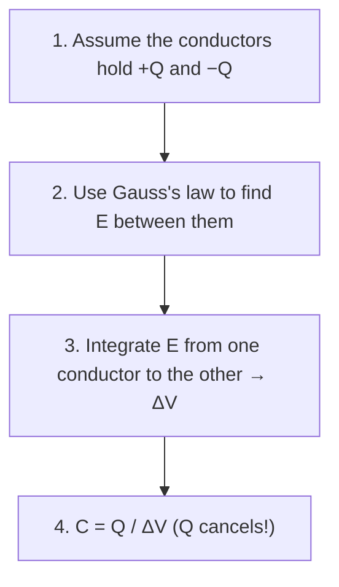

# Capacitors and Dielectrics

### The core idea

A capacitor is **two conductors separated by an insulator or vacuum**. A battery connected across it moves electrons from one conductor to the other, leaving one at $+Q$ and the other at $-Q$.

**Capacitance $C$** measures how much charge the pair stores per volt of potential difference:

$$
C = \frac{Q}{\Delta V} \qquad \text{(unit: farad, F = C/V)}
$$


> [!IMPORTANT]
>
> **$C$ depends only on the geometry and the material between the plates.** It does **not** depend on $Q$ or $V$.

### General method for finding $C$



If $Q$ doesn't cancel at the end, you made a mistake somewhere.

### The three standard geometries (derive each one yourself)

**① Parallel plates** (area $A$, gap $d$):
Gauss → $E = \dfrac{\sigma}{\varepsilon_0} = \dfrac{Q}{\varepsilon_0 A}$ → $\Delta V = Ed = \dfrac{Qd}{\varepsilon_0 A}$ →

$$
\boxed{C = \frac{\varepsilon_0 A}{d} = \frac{A}{4\pi K d}}
$$


**② Cylindrical (coaxial)** (inner radius $a$, outer radius $b$, length $H$):
Gauss with a cylinder of radius $r$, length $H$ ($a<r<b$): $E \cdot 2\pi r H = \dfrac{Q}{\varepsilon_0}$ → $E = \dfrac{Q}{2\pi\varepsilon_0 H r} = \dfrac{2KQ}{Hr}$

$$
\Delta V = \int_a^b \frac{2KQ}{Hr}\,dr = \frac{2KQ}{H}\ln\frac{b}{a}
$$


$$
\boxed{C = \frac{2\pi\varepsilon_0 H}{\ln(b/a)} = \frac{H}{2K\ln(b/a)}}
$$


**③ Spherical** (radii $a < b$):
$E = \dfrac{KQ}{r^2}$ → $\Delta V = KQ\left(\dfrac1a - \dfrac1b\right)$ →

$$
\boxed{C = \frac{ab}{K(b-a)} = \frac{4\pi\varepsilon_0\,ab}{b-a}}
$$


> [!TIP]
>
> **Sanity checks:** Bigger plates → bigger $C$. Plates closer → bigger $C$. Notice that the capacitance of a long coax is **proportional to its length $H$**. Two half-length coaxes side by side add up to one full-length one. This becomes important for partially filled capacitors below.

### Dielectrics

A **dielectric** is an insulator (plastic, glass, oil, fuel, paper…) placed between the plates. Its molecules **stretch and line up** (they *polarize*) so that they **partly cancel** the field inside.

| | Without dielectric | Filled with dielectric $\kappa$ |
|---|---|---|
| Capacitance | $C_0$ | $C = \kappa C_0$ (always bigger, since $\kappa \ge 1$) |
| Field (same $Q$) | $E_0$ | $E = E_0/\kappa$ |
| In formulas | $\varepsilon_0$ | replace with $\kappa\varepsilon_0$ (or $K \to K/\kappa$) |

$\kappa_{\text{vacuum}} = 1$, $\kappa_{\text{air}} \approx 1$.

### Partially filled capacitors: the field-line test

To decide how to combine the pieces, ask:

> **"Does one single field line have to pass through both materials?"**
> - **YES** → the materials are **stacked** along the field → treat as capacitors in **SERIES**.
> - **NO** (each field line goes through only one material) → they're **side by side** → treat as capacitors in **PARALLEL**.

```text
 SERIES (stacked)                      PARALLEL (side by side)
 ┌──────────────────┐ +               ┌─────────┬────────┐ +
 │   air            │                 │         │        │
 │──────────────────│  E ↓            │  air    │   κ    │  E ↓
 │   κ  (dielectric)│                 │         │        │
 └──────────────────┘ −               └─────────┴────────┘ −
 a field line crosses BOTH            each field line stays in ONE
```

**Parallel plates, dielectric filling a fraction $f$ of the AREA (side by side):**

$$
C = \frac{\varepsilon_0 (fA)\kappa}{d} + \frac{\varepsilon_0 (1-f)A}{d}
$$


**Parallel plates, dielectric slab of thickness $t$ filling the full area (stacked):**

$$
\frac1C = \frac{d-t}{\varepsilon_0 A} + \frac{t}{\kappa\varepsilon_0 A}
$$


### Worked example 2.1: A coax with a dielectric sleeve

A coaxial capacitor (length $H$, inner radius $a$, outer radius $b$) has a dielectric tube ($\kappa$) wrapped snugly around the inner rod, filling $a < r < c$. The rest ($c < r < b$) is air. Find $C$.

<Solution>

**Single-field-line test:** The field is **radial**. A field line starting on the rod travels outward through the dielectric **and then** through the air. It crosses **both** → **series**.

Inner piece (dielectric, from $a$ to $c$): $C_1 = \dfrac{2\pi\kappa\varepsilon_0 H}{\ln(c/a)}$
Outer piece (air, from $c$ to $b$): $C_2 = \dfrac{2\pi\varepsilon_0 H}{\ln(b/c)}$


$$
\frac{1}{C} = \frac{\ln(c/a)}{2\pi\kappa\varepsilon_0 H} + \frac{\ln(b/c)}{2\pi\varepsilon_0 H}
$$


✓ **Check:** If $\kappa = 1$: $\ln(c/a) + \ln(b/c) = \ln(b/a)$, so we recover the plain coax.

> **General approach:** Before computing anything, **sketch the field lines** and run the single-field-line test. If the lines pass through layer after layer, chain the pieces in **series**. If the material splits the capacitor into regions that the field lines never cross between, cut the capacitor into separate **parallel** pieces. Compute each piece's $C$ with its own geometry and its own $\kappa$ (remember: a coax piece's $C$ is proportional to **its own length**), then add.

</Solution>

### Combining capacitors

| | **Parallel** (same two nodes) | **Series** (one after another, no branch between) |
|---|---|---|
| What's shared | Same $\Delta V$ | Same $Q$ |
| Equivalent | $C_{\text{eq}} = C_1 + C_2 + \dots$ | $\dfrac{1}{C_{\text{eq}}} = \dfrac{1}{C_1} + \dfrac{1}{C_2} + \dots$ |
| Intuition | Like adding plate area: $C$ increases | Like widening the gap: $C$ decreases |

> [!WARNING]
>
> **Capacitors combine "backwards" compared to resistors.** Series capacitors use the $1/C$ rule. Parallel capacitors just add. Two in series: $C_{\text{eq}} = \dfrac{C_1 C_2}{C_1 + C_2}$ (product over sum). This is *always smaller than the smallest one*.

### Energy stored in a capacitor

Each additional bit of charge has to be pushed against the field of the charge already there, so charging takes work. That work is stored as:


$$
\boxed{U = \frac{Q^2}{2C} = \frac12 C(\Delta V)^2 = \frac12 Q\,\Delta V}
$$


Where does the energy live? **In the electric field itself.** Energy per volume:

$$
u_E = \tfrac12 \varepsilon_0 E^2 \qquad (\text{in a dielectric: } \tfrac12\kappa\varepsilon_0E^2)
$$


Check with parallel plates: $u_E \times (\text{volume } Ad) = \tfrac12\varepsilon_0\left(\tfrac{Q}{\varepsilon_0 A}\right)^2 Ad = \dfrac{Q^2 d}{2\varepsilon_0 A} = \dfrac{Q^2}{2C}$ ✓

> [!IMPORTANT]
>
> **Energy grows like the **square** of the charge (or voltage).** Half the charge → only one quarter of the energy. This matters a lot in RC circuits (Chapter 5).

### Connected or isolated? The first question when a capacitor changes

When a capacitor's shape changes (plates moved, dielectric inserted…), first ask: **Is it still connected to the battery?**

| Situation | What stays FIXED | Use this energy formula |
|---|---|---|
| **Still connected to a battery** | $\Delta V$ (the battery holds it) | $U = \tfrac12 C(\Delta V)^2$ |
| **Disconnected / isolated** | $Q$ (charge has nowhere to go) | $U = \dfrac{Q^2}{2C}$ |

Then follow the chain: change in shape → change in $C$ → (fixed quantity) → everything else.

#### Worked example 2.2: Inserting a dielectric (two ways)

A capacitor $C_0$ has been charged to voltage $V_0$. A slab with $\kappa = 3$ is slid in to fill it completely.

<Solution>

*(a) Battery still connected:* $V = V_0$ (fixed). $C = 3C_0$. $Q = CV = 3Q_0$ (the battery pumps in more charge). $U = \tfrac12(3C_0)V_0^2 = 3U_0$. **Energy triples.**

*(b) Battery disconnected first:* $Q = Q_0$ (fixed). $C = 3C_0$. $V = Q/C = V_0/3$. $U = Q_0^2/(2\cdot 3C_0) = U_0/3$. **Energy drops to one third.** (The slab is actually *sucked in*; the field does work on it.)

Same action, **opposite** energy result. Always ask this question first.

</Solution>

> [!WARNING]
>
> **"Energy must be conserved, so U doesn't change"** is a classic wrong reason. Energy *of the whole universe* is conserved, but the capacitor can trade energy with the battery, with your hand (pushing plates), or with heat in a resistor. The capacitor's own $U$ can absolutely change.

<Quiz id="cap-1" />

<Quiz id="cap-2" />

<Quiz id="cap-3" />

<ChapterComplete slug="capacitors" />
