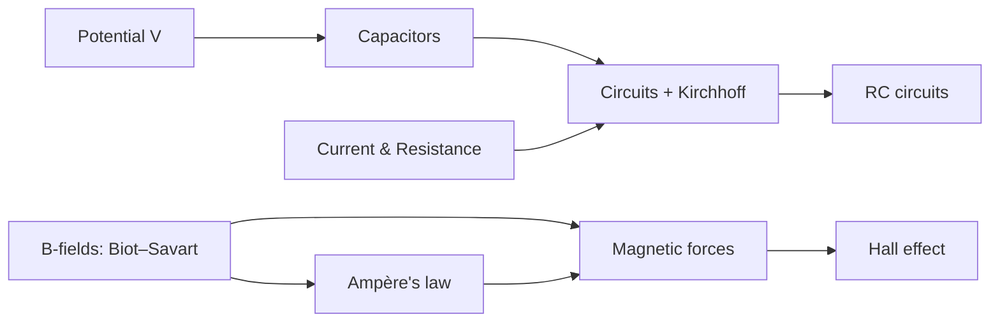

# Exam Overview

Your course splits topics into **Focus (F)** (definitely tested, probably more than once) and **Eligible (E)** (fair game, but less emphasized).

### Focus topics for Exam 2

| Code | What it means in plain words | Chapter here |
|---|---|---|
| **2.2** | Find the electric potential $V$ of charges, rods, rings, capacitors, conductors | [1](/electric-potential) |
| **2.3** | Draw and reason with equipotential lines | [1](/electric-potential) |
| **2.4** | Connect $V$, $\vec E$ and potential energy $U$ | [1](/electric-potential) |
| **2.5** | What a battery's emf really is | [4](/dc-circuits) |
| **2.6** | Energy stored in electric (and magnetic) fields | [2](/capacitors), [9](/magnetic-materials) |
| **3.1** | Capacitance from shape + dielectrics; $Q = CV$ | [2](/capacitors) |
| **3.2** | Microscopic picture (electrons, drift) ↔ macroscopic quantities (current, resistance, Ohm's law) | [3](/current-and-resistance) |
| **3.5** | Redraw circuits; simplify to equivalents | [4](/dc-circuits) |
| **3.6** | Series/parallel R, C, batteries | [2](/capacitors), [4](/dc-circuits) |
| **3.7** | Energy and power in circuit pieces | [4](/dc-circuits) |
| **3.8** | Kirchhoff's laws | [4](/dc-circuits) |
| **3.9** | Charging and discharging (RC, plus a peek at LR, LC) | [5](/rc-circuits) |
| **3.10** | "What happens if…?" circuit reasoning | [4](/dc-circuits), [5](/rc-circuits) |
| **1.4** | Magnetic field from moving charges, wires, loops, dipoles | [6](/biot-savart) |
| **4.4** | Ampère's law with symmetry | [7](/amperes-law) |
| **1.5** | Magnetic forces on charges and wires; torque on loops | [8](/magnetic-forces) |
| **1.6** | Hall effect; magnetic materials | [8](/magnetic-forces), [9](/magnetic-materials) |

### Eligible topics (from Exam 1)
Coulomb's law, electric fields of charges/dipoles/continuous charge, Gauss's law, flux, potential energy of point charges, **mechanics** (Newton's laws, circular motion, energy), and **math** (integrals, vectors, trig, "what happens to Y if X doubles?").

> [!IMPORTANT]
>
> **Exam format (from the practice exams):** 6 multiple-choice questions + 4 free-response problems. For free response, **every answer must show work**. When the problem says so, you may leave an answer as an **unevaluated definite integral**. For **Gauss's law and Ampère's law**, you must say clearly **which surface or loop** you use and **what charge or current is enclosed**. These are easy points; never skip them.

<ChapterComplete slug="overview" />
