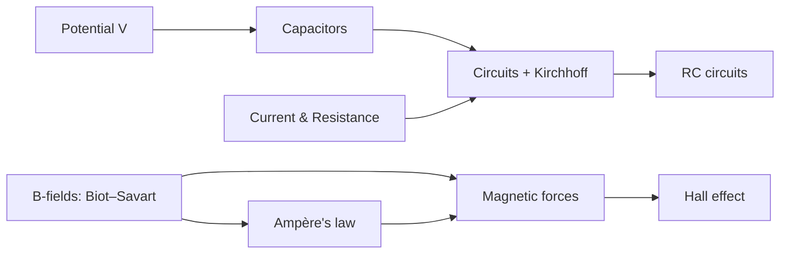
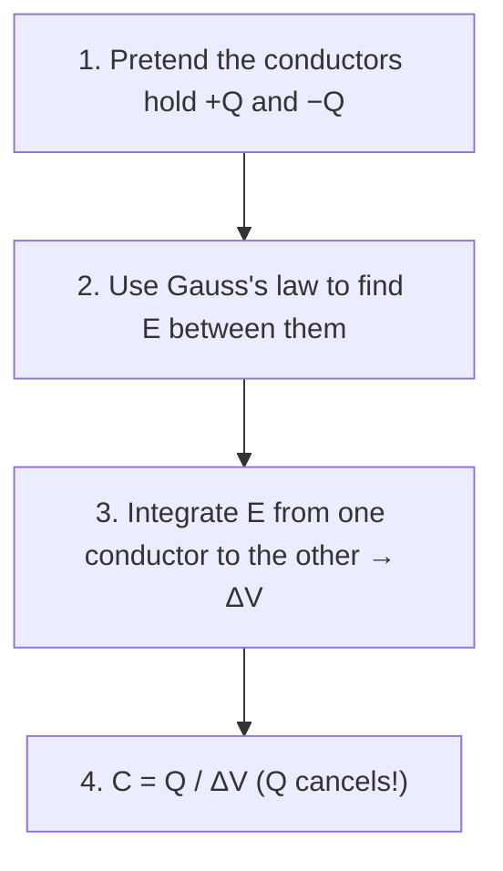

# PHYS 10320 — Exam 2 Study Guide

> **How to use this guide:** If you can explain each *core idea* section in your own words, and work every *worked example* without looking at the solution, you are well prepared for Exam 2.

---

## 0. Exam Overview

Your course splits topics into **Focus (F)** (definitely tested, probably more than once) and **Eligible (E)** (fair game, but less emphasized).

### Focus topics for Exam 2

| Code | What it means in plain words | Chapter here |
|---|---|---|
| **2.2** | Find the electric potential $V$ of charges, rods, rings, capacitors, conductors | [1](/learn/1) |
| **2.3** | Draw and reason with equipotential lines | [1](/learn/1) |
| **2.4** | Connect $V$, $\vec E$ and potential energy $U$ | [1](/learn/1) |
| **2.5** | What a battery's emf really is | [4](/learn/4) |
| **2.6** | Energy stored in electric (and magnetic) fields | [2](/learn/2), [9](/learn/9) |
| **3.1** | Capacitance from shape + dielectrics; $Q = CV$ | [2](/learn/2) |
| **3.2** | Microscopic picture (electrons, drift) ↔ macroscopic quantities (current, resistance, Ohm's law) | [3](/learn/3) |
| **3.5** | Redraw circuits; simplify to equivalents | [4](/learn/4) |
| **3.6** | Series/parallel R, C, batteries | [2](/learn/2), [4](/learn/4) |
| **3.7** | Energy and power in circuit pieces | [4](/learn/4) |
| **3.8** | Kirchhoff's laws | [4](/learn/4) |
| **3.9** | Charging and discharging (RC, plus a peek at LR, LC) | [5](/learn/5) |
| **3.10** | "What happens if…?" circuit reasoning | [4](/learn/4), [5](/learn/5) |
| **1.4** | Magnetic field from moving charges, wires, loops, dipoles | [6](/learn/6) |
| **4.4** | Ampère's law with symmetry | [7](/learn/7) |
| **1.5** | Magnetic forces on charges and wires; torque on loops | [8](/learn/8) |
| **1.6** | Hall effect; magnetic materials | [8](/learn/8), [9](/learn/9) |

### Eligible topics (from Exam 1)
Coulomb's law, electric fields of charges/dipoles/continuous charge, Gauss's law, flux, potential energy of point charges, **mechanics** (Newton's laws, circular motion, energy), and **math** (integrals, vectors, trig, "what happens to Y if X doubles?").

> [!IMPORTANT]
> **Exam format (from the practice exams):** 6 multiple-choice questions + 4 free-response problems. For free response, **every answer must show work**. When the problem says so, you may leave an answer as an **unevaluated definite integral**. For **Gauss's law and Ampère's law**, you must say clearly **which surface or loop** you use and **what charge or current is enclosed**. These are easy points; never skip them.



---

## 1. Electric Potential

### The core idea

The **electric potential $V$** (in volts) assigns a number to every point in space: the potential energy per unit charge that a test charge would have there. A useful picture is a landscape in which $V$ plays the role of height.

- A **positive charge** moves toward **lower** $V$, like a ball rolling downhill.
- A **negative charge** moves toward **higher** $V$, because for $q < 0$ a higher $V$ means a lower $U = qV$.
- In both cases the charge is doing the same thing: **lowering its potential energy $U$**.

The **electric field $\vec E$** is the slope of this landscape. It points from high $V$ to low $V$, and it is **stronger where $V$ changes more quickly** with distance.

> [!TIP]
> **Summary:**
> $$U = qV \qquad \vec E \text{ points toward lower } V \qquad \text{faster change in } V = \text{stronger } \vec E$$

### The key formulas

| Idea | Formula | In words |
|---|---|---|
| Potential of a point charge | $V = \dfrac{Kq}{r}$ (zero at infinity) | Positive charges raise $V$ nearby; negative charges lower it |
| Many charges (**superposition**) | $V = \sum_i \dfrac{Kq_i}{r_i}$ | Potentials are scalars, so they simply add |
| Continuous charge | $V = \displaystyle\int \dfrac{K\,dq}{r}$ | Split the charge into pieces $dq$ and sum |
| Potential energy of a charge | $U = qV$ | Charge times potential |
| Change in energy | $\Delta U = q\,\Delta V$ | |
| Work by the field | $W_{\text{field}} = -\Delta U$ | |
| $V$ from $\vec E$ | $\Delta V = V_b - V_a = -\displaystyle\int_a^b \vec E \cdot d\vec\ell$ | Moving along $\vec E$ lowers $V$ |
| $\vec E$ from $V$ | $E_x = -\dfrac{\partial V}{\partial x}$, etc. | $\vec E$ is minus the gradient of $V$ |
| Uniform field | $\lvert\Delta V\rvert = E\,d$ | Uniform field |
| Energy of a group of charges | $U = \sum_{\text{pairs}} \dfrac{K q_i q_j}{r_{ij}}$ | Count each pair **once** |

$K = \dfrac{1}{4\pi\varepsilon_0} \approx 8.99\times 10^9\ \text{N·m}^2/\text{C}^2$

> [!NOTE]
> **Why potential is easier than field:** $V$ is a plain number (a **scalar**). When you add up potentials from many charges, you just add numbers. With $\vec E$ you have to add arrows and break them into components. So when a problem lets you pick, **find $V$ first, then take a derivative to get $\vec E$.**

### Equipotentials

An **equipotential** is a line (or surface) where $V$ is the same everywhere, just like a contour line on a hiking map.

Four rules:

1. **$\vec E$ is always perpendicular to equipotentials.** (The steepest way down a hill is straight across the contour lines, never along them.)
2. **$\vec E$ points from higher $V$ to lower $V$.**
3. **Lines close together → strong field.** Lines far apart → weak field. (Closely spaced contour lines mean steep ground.)
4. **Moving along an equipotential costs zero work.** (Walking along a contour line, you never go up or down.)

```text
   +30V     +20V     +10V      0V     -10V
    |        |        |        |        |
    |  ───►  |  ───►  |  ───►  |  ───►  |      E points this way (high → low)
    |        |        |        |        |
                                          ● proton here → pushed RIGHT  (rolls downhill)
                                          ● electron here → pushed LEFT (floats uphill)
```

> [!WARNING]
> **Trap:** Students remember "charges move along $\vec E$" and forget the sign. **Only positive charges** go along $\vec E$. **Negative charges go opposite to $\vec E$**, toward **higher** potential. Before answering any direction question, check the sign of the charge.

**Reading an equipotential diagram, step by step:**
1. Find which side has higher numbers (higher $V$).
2. At your point, imagine the line **perpendicular** to the equipotential through that point.
3. $\vec E$ points along that perpendicular **toward the lower-$V$ side**.
4. Force: $\vec F = q\vec E$. Positive → same way as $\vec E$. Negative → opposite.
5. Strongest field? Look where the lines are **squeezed closest together**.

### Conductors in equilibrium

When charges in a conductor stop moving (**electrostatic equilibrium**):
- $\vec E = 0$ **inside** the metal.
- So the **whole conductor is a single equipotential**: same $V$ everywhere, inside and on the surface. (This does **not** mean $V = 0$.)
- Any extra charge sits on the **outer surface**.
- Just outside, $\vec E$ is **perpendicular** to the surface.
- For a sphere of radius $R$ with charge $Q$: $V = \dfrac{KQ}{R}$ at the surface **and everywhere inside**.

> *Why:* free electrons in a conductor move whenever a potential difference exists inside it, so they keep redistributing until every point is at the same $V$.

### Worked example 1.1: Potential on the axis of a charged rod

A thin rod of length $L$ has uniform charge density $\lambda$. It lies on the $x$-axis from $x = 0$ to $x = L$. Find $V$ at a point on the axis at $x = -d$ (a distance $d$ to the left of the rod's end).

**Step 1: Divide the rod.** Take a small piece at position $x$, of length $dx$. Its charge is $dq = \lambda\,dx$.

**Step 2: Distance.** From the point at $-d$ to the piece at $x$: $r = x + d$.

**Step 3: Integrate.**
$$V = \int_0^L \frac{K\lambda\,dx}{x+d} = K\lambda\,\ln\!\left(\frac{L+d}{d}\right)$$

**Step 4: Sanity check (limiting case).** If $d \gg L$: $\ln(1 + L/d) \approx L/d$, so $V \approx \dfrac{K\lambda L}{d} = \dfrac{KQ}{d}$. ✓ It looks like a point charge from far away.

**Step 5 (bonus): Get the field.** Treat $d$ as the variable: as you move left, $d$ grows. $E = -\dfrac{dV}{d(\text{position})}$ gives
$E = K\lambda\left(\dfrac1d - \dfrac{1}{L+d}\right)$, pointing **away** from the rod (left) if $\lambda > 0$. ✓ Matches what you'd get from Coulomb's law.

### Worked example 1.2: Ring of charge → field from potential

Ring of radius $R$, total charge $Q$. Point on the axis, distance $z$ from the center.

Every bit of the ring is the **same distance** $\sqrt{R^2+z^2}$ away, so:
$$V(z) = \frac{KQ}{\sqrt{R^2 + z^2}}$$

Now take the slope: $E_z = -\dfrac{dV}{dz} = \dfrac{KQz}{(R^2+z^2)^{3/2}}$ ✓ (the same answer you got with much more pain in Exam 1).

### Potential energy and motion: energy conservation

When a charge moves only because of electric forces:
$$K_i + qV_i = K_f + qV_f \quad\Longrightarrow\quad \tfrac12 m v_f^2 = \tfrac12 m v_i^2 - q\,(V_f - V_i)$$

Example: An electron ($q = -e$) released from rest goes from $V = 0$ to $V = +100$ V. Then $\Delta U = (-e)(100\text{ V}) < 0$: it **loses** potential energy and **gains** $100$ eV of kinetic energy.

```quiz
id: potential-1
question: "A proton is released from rest in a region where the potential decreases as you move in the +y direction. Which way does it accelerate?"
options:
  - text: "+y"
    correct: true
  - text: "−y"
  - text: "It doesn't move, because V is not zero"
  - text: "Perpendicular to y"
explanation: "E points toward lower V, so E points along +y. A proton is positive, so it is pushed along E."
```

```quiz
id: potential-2
question: "On a map of equipotentials, where is the electric field strongest?"
options:
  - text: "Where the equipotential lines are farthest apart"
  - text: "Where the equipotential lines are closest together"
    correct: true
  - text: "Where V is largest"
  - text: "Where V = 0"
explanation: "|E| ≈ ΔV/Δs. For the same ΔV between neighboring lines, a smaller spacing Δs means a bigger field. A large V by itself says nothing about the field. Only the steepness matters."
```

```quiz
id: potential-3
question: "An electron is free to move. Compared with where it starts, where does it tend to go?"
options:
  - text: "Toward lower potential"
  - text: "Toward higher potential"
    correct: true
  - text: "Along the electric field"
  - text: "Nowhere, because electrons are always in equilibrium"
explanation: "U = qV with q < 0. To lower U, the electron must go to higher V. That's the same as moving opposite to E."
```

---

## 2. Capacitors and Dielectrics

### The core idea

A capacitor is **two conductors separated by an insulator or vacuum**. A battery connected across it moves electrons from one conductor to the other, leaving one at $+Q$ and the other at $-Q$.

**Capacitance $C$** measures how much charge the pair stores per volt of potential difference:
$$C = \frac{Q}{\Delta V} \qquad \text{(unit: farad, F = C/V)}$$

> [!IMPORTANT]
> **$C$ depends only on the geometry and the material between the plates.** It does **not** depend on $Q$ or $V$.

### General method for finding $C$



If $Q$ doesn't cancel at the end, you made a mistake somewhere.

### The three standard geometries (derive each one yourself)

**① Parallel plates** (area $A$, gap $d$):
Gauss → $E = \dfrac{\sigma}{\varepsilon_0} = \dfrac{Q}{\varepsilon_0 A}$ → $\Delta V = Ed = \dfrac{Qd}{\varepsilon_0 A}$ →
$$\boxed{C = \frac{\varepsilon_0 A}{d} = \frac{A}{4\pi K d}}$$

**② Cylindrical (coaxial)** (inner radius $a$, outer radius $b$, length $H$):
Gauss with a cylinder of radius $r$, length $H$ ($a<r<b$): $E \cdot 2\pi r H = \dfrac{Q}{\varepsilon_0}$ → $E = \dfrac{Q}{2\pi\varepsilon_0 H r} = \dfrac{2KQ}{Hr}$
$$\Delta V = \int_a^b \frac{2KQ}{Hr}\,dr = \frac{2KQ}{H}\ln\frac{b}{a}$$
$$\boxed{C = \frac{2\pi\varepsilon_0 H}{\ln(b/a)} = \frac{H}{2K\ln(b/a)}}$$

**③ Spherical** (radii $a < b$):
$E = \dfrac{KQ}{r^2}$ → $\Delta V = KQ\left(\dfrac1a - \dfrac1b\right)$ →
$$\boxed{C = \frac{ab}{K(b-a)} = \frac{4\pi\varepsilon_0\,ab}{b-a}}$$

> [!TIP]
> **Sanity checks:** Bigger plates → bigger $C$. Plates closer → bigger $C$. Notice that the capacitance of a long coax is **proportional to its length $H$**. Two half-length coaxes side by side add up to one full-length one. This becomes important for partially filled capacitors below.

### Dielectrics

A **dielectric** is an insulator (plastic, glass, oil, fuel, paper…) placed between the plates. Its molecules **stretch and line up** (they *polarize*) so that they **partly cancel** the field inside.

| | Without dielectric | Filled with dielectric $\kappa$ |
|---|---|---|
| Capacitance | $C_0$ | $C = \kappa C_0$ (always bigger, since $\kappa \ge 1$) |
| Field (same $Q$) | $E_0$ | $E = E_0/\kappa$ |
| In formulas | $\varepsilon_0$ | replace with $\kappa\varepsilon_0$ (or $K \to K/\kappa$) |

$\kappa_{\text{vacuum}} = 1$, $\kappa_{\text{air}} \approx 1$.

### Partially filled capacitors: the field-line test

To decide how to combine the pieces, ask:

> **"Does one single field line have to pass through both materials?"**
> - **YES** → the materials are **stacked** along the field → treat as capacitors in **SERIES**.
> - **NO** (each field line goes through only one material) → they're **side by side** → treat as capacitors in **PARALLEL**.

```text
 SERIES (stacked)                      PARALLEL (side by side)
 ┌──────────────────┐ +               ┌─────────┬────────┐ +
 │   air            │                 │         │        │
 │──────────────────│  E ↓            │  air    │   κ    │  E ↓
 │   κ  (dielectric)│                 │         │        │
 └──────────────────┘ −               └─────────┴────────┘ −
 a field line crosses BOTH            each field line stays in ONE
```

**Parallel plates, dielectric filling a fraction $f$ of the AREA (side by side):**
$$C = \frac{\varepsilon_0 (fA)\kappa}{d} + \frac{\varepsilon_0 (1-f)A}{d}$$

**Parallel plates, dielectric slab of thickness $t$ filling the full area (stacked):**
$$\frac1C = \frac{d-t}{\varepsilon_0 A} + \frac{t}{\kappa\varepsilon_0 A}$$

### Worked example 2.1: A coax with a dielectric sleeve

A coaxial capacitor (length $H$, inner radius $a$, outer radius $b$) has a dielectric tube ($\kappa$) wrapped snugly around the inner rod, filling $a < r < c$. The rest ($c < r < b$) is air. Find $C$.

**Single-field-line test:** The field is **radial**. A field line starting on the rod travels outward through the dielectric **and then** through the air. It crosses **both** → **series**.

Inner piece (dielectric, from $a$ to $c$): $C_1 = \dfrac{2\pi\kappa\varepsilon_0 H}{\ln(c/a)}$
Outer piece (air, from $c$ to $b$): $C_2 = \dfrac{2\pi\varepsilon_0 H}{\ln(b/c)}$

$$\frac{1}{C} = \frac{\ln(c/a)}{2\pi\kappa\varepsilon_0 H} + \frac{\ln(b/c)}{2\pi\varepsilon_0 H}$$

✓ **Check:** If $\kappa = 1$: $\ln(c/a) + \ln(b/c) = \ln(b/a)$, so we recover the plain coax.

> **General approach:** Before computing anything, **sketch the field lines** and run the single-field-line test. If the lines pass through layer after layer, chain the pieces in **series**. If the material splits the capacitor into regions that the field lines never cross between, cut the capacitor into separate **parallel** pieces. Compute each piece's $C$ with its own geometry and its own $\kappa$ (remember: a coax piece's $C$ is proportional to **its own length**), then add.

### Combining capacitors

| | **Parallel** (same two nodes) | **Series** (one after another, no branch between) |
|---|---|---|
| What's shared | Same $\Delta V$ | Same $Q$ |
| Equivalent | $C_{\text{eq}} = C_1 + C_2 + \dots$ | $\dfrac{1}{C_{\text{eq}}} = \dfrac{1}{C_1} + \dfrac{1}{C_2} + \dots$ |
| Intuition | Like adding plate area: $C$ increases | Like widening the gap: $C$ decreases |

> [!WARNING]
> **Capacitors combine "backwards" compared to resistors.** Series capacitors use the $1/C$ rule. Parallel capacitors just add. Two in series: $C_{\text{eq}} = \dfrac{C_1 C_2}{C_1 + C_2}$ (product over sum). This is *always smaller than the smallest one*.

### Energy stored in a capacitor

Each additional bit of charge has to be pushed against the field of the charge already there, so charging takes work. That work is stored as:

$$\boxed{U = \frac{Q^2}{2C} = \frac12 C(\Delta V)^2 = \frac12 Q\,\Delta V}$$

Where does the energy live? **In the electric field itself.** Energy per volume:
$$u_E = \tfrac12 \varepsilon_0 E^2 \qquad (\text{in a dielectric: } \tfrac12\kappa\varepsilon_0E^2)$$

Check with parallel plates: $u_E \times (\text{volume } Ad) = \tfrac12\varepsilon_0\left(\tfrac{Q}{\varepsilon_0 A}\right)^2 Ad = \dfrac{Q^2 d}{2\varepsilon_0 A} = \dfrac{Q^2}{2C}$ ✓

> [!IMPORTANT]
> **Energy grows like the **square** of the charge (or voltage).** Half the charge → only one quarter of the energy. This matters a lot in RC circuits (Chapter 5).

### Connected or isolated? The first question when a capacitor changes

When a capacitor's shape changes (plates moved, dielectric inserted…), first ask: **Is it still connected to the battery?**

| Situation | What stays FIXED | Use this energy formula |
|---|---|---|
| **Still connected to a battery** | $\Delta V$ (the battery holds it) | $U = \tfrac12 C(\Delta V)^2$ |
| **Disconnected / isolated** | $Q$ (charge has nowhere to go) | $U = \dfrac{Q^2}{2C}$ |

Then follow the chain: change in shape → change in $C$ → (fixed quantity) → everything else.

**Worked example 2.2: Inserting a dielectric (two ways)**

A capacitor $C_0$ has been charged to voltage $V_0$. A slab with $\kappa = 3$ is slid in to fill it completely.

*(a) Battery still connected:* $V = V_0$ (fixed). $C = 3C_0$. $Q = CV = 3Q_0$ (the battery pumps in more charge). $U = \tfrac12(3C_0)V_0^2 = 3U_0$. **Energy triples.**

*(b) Battery disconnected first:* $Q = Q_0$ (fixed). $C = 3C_0$. $V = Q/C = V_0/3$. $U = Q_0^2/(2\cdot 3C_0) = U_0/3$. **Energy drops to one third.** (The slab is actually *sucked in*; the field does work on it.)

Same action, **opposite** energy result. Always ask this question first.

> [!WARNING]
> **"Energy must be conserved, so U doesn't change"** is a classic wrong reason. Energy *of the whole universe* is conserved, but the capacitor can trade energy with the battery, with your hand (pushing plates), or with heat in a resistor. The capacitor's own $U$ can absolutely change.

```quiz
id: cap-1
question: "An isolated (disconnected) parallel-plate capacitor holds charge Q. You pull the plates farther apart. What happens to the stored energy?"
options:
  - text: "Increases"
    correct: true
  - text: "Decreases"
  - text: "Stays the same because Q is fixed"
  - text: "Stays the same because energy is conserved"
explanation: "Isolated → Q fixed. Larger d → smaller C = ε₀A/d. U = Q²/(2C) → larger. The extra energy came from the work YOU did pulling the attracting plates apart."
```

```quiz
id: cap-2
question: "A 6 μF and a 3 μF capacitor are in series across a 9 V battery. What is the charge on the 3 μF capacitor?"
options:
  - text: "27 μC"
  - text: "18 μC"
    correct: true
  - text: "54 μC"
  - text: "9 μC"
explanation: "C_eq = (6·3)/(6+3) = 2 μF. Q = C_eq·V = 18 μC. In series, every capacitor carries the same charge, so both have 18 μC."
```

```quiz
id: cap-3
question: "A parallel-plate capacitor is half filled side by side (left half of the area has κ, right half is air, both span the full gap). Its capacitance is:"
options:
  - text: "ε₀A(1+κ)/(2d)"
    correct: true
  - text: "2κε₀A/((1+κ)d)"
  - text: "κε₀A/d"
  - text: "ε₀A/(2κd)"
explanation: "Each field line goes straight down through only one material → parallel. Each half has area A/2: C = κε₀(A/2)/d + ε₀(A/2)/d."
```

---

## 3. Current and Resistance

### The core idea

A metal wire contains an enormous number of free electrons. When a battery is connected, an electric field is set up inside the wire and pushes on all of them. They collide with the atomic lattice constantly, so their average **drift velocity** is small (around a millimeter per second), but the whole population starts drifting **at the same time**, which is why a circuit responds almost instantly.

- **Current $I$** = how much charge passes a doorway per second. $I = \dfrac{dQ}{dt}$ (amperes, A = C/s).
- **Current density $J$** = current per area of doorway. $J = I/A$.
- **Resistance $R$** = how strongly a component opposes current: $R = \Delta V / I$.

### Microscopic and macroscopic descriptions

| Microscopic | Macroscopic |
|---|---|
| $n$ = carriers per m³, $q$ = charge each, $v_d$ = drift speed | $I = n\,\lvert q\rvert\,v_d\,A$ |
| $J = n\,\lvert q\rvert\,v_d$ | $I = JA$ |
| $\vec J = \sigma\vec E$ (Ohm's law, microscopic form) | $\Delta V = IR$ (Ohm's law, circuit form) |
| Conductivity $\sigma$, resistivity $\rho = 1/\sigma$ | $R = \dfrac{\rho L}{A}$ |
| Field inside wire | $E = \dfrac{\Delta V}{L}$ |

> [!NOTE]
> **Wait, isn't $E = 0$ inside conductors?** Only when nothing is moving (equilibrium). A wire carrying current is **not** in equilibrium. A small field inside the wire drives the current.

### Resistance of a wire: $R = \rho L / A$

- **Longer** wire ($L$↑) → **more** resistance.
- **Larger** cross-section ($A$↑) → **less** resistance.
- **Material** matters through $\rho$ (copper: tiny $\rho$; rubber: huge $\rho$).

> [!TIP]
> **Reshaping a wire (squishing or stretching):** The amount of metal doesn't change, so **volume $LA$ stays constant**. If you change $L$ by a factor $s$, then $A$ changes by $1/s$, and
> $$R_{\text{new}} = \rho\frac{sL}{A/s} = s^2 R$$
> Example: **squash** a wire to **half** its length (it gets fatter) → $R$ becomes $R/4$.

**Worked example 3.1: Comparing two wires**
Wire X: length $2L$, area $3A$. Wire Y: length $L$, area $A$. Same metal.
$R_X = \rho\dfrac{2L}{3A} = \tfrac23\,\rho\dfrac{L}{A}$, $R_Y = \rho\dfrac{L}{A}$. → **X has less resistance.** Always write each one as a multiple of $\rho L/A$ and compare the numbers.

### Same current, different cross-sections

Two wires of **different thickness** joined end to end (series) carry the **same current $I$** (charge can't pile up in the middle). But in the **thinner** wire:
- $J = I/A$ is **bigger**
- $v_d = J/(n\lvert q\rvert)$ is **bigger**
- $E = J/\sigma$ is **bigger**

### Power

$$P = I\,\Delta V = I^2R = \frac{(\Delta V)^2}{R}$$

Use whichever form uses what you know. For a battery: $P_{\text{delivered}} = \varepsilon I$.

```quiz
id: res-1
question: "You keep the length of a copper wire fixed but double its diameter. Its resistance becomes:"
options:
  - text: "R/2"
  - text: "R/4"
    correct: true
  - text: "2R"
  - text: "R/8"
explanation: "A = πr². Double the diameter → 4× the area → R = ρL/A becomes R/4."
```

```quiz
id: res-2
question: "In the thin section of a wire joined to a thick section, compared to the thick section, the current is ___ and the drift speed is ___."
options:
  - text: "the same; larger"
    correct: true
  - text: "larger; larger"
  - text: "smaller; the same"
  - text: "the same; the same"
explanation: "Current is conserved along a single path. Same I through a smaller A means larger J = n|q|v_d, so faster drift."
```

---

## 4. DC Circuits and Kirchhoff's Rules

### The core idea

A pump analogy captures most of how circuits behave:
- A **battery** acts like a pump: it raises each coulomb of charge to a higher potential. The rise per coulomb is the **emf $\varepsilon$**.
- A **resistor** is where that potential is used up: charge drops in potential as it passes through.
- An **ideal wire** has no resistance, so there is **no potential change** along it.
- Going all the way around any closed loop returns you to the **same potential** you started from.

### emf vs. potential difference (LO 2.5)

- **emf $\varepsilon$** = the work the battery's chemistry does **per coulomb** to push charge from its $-$ terminal to its $+$ terminal (uphill, against the electric field).
- **Terminal voltage** = the actual $\Delta V$ across the battery's terminals.
  - Ideal battery: $\Delta V = \varepsilon$ always.
  - Real battery with internal resistance $r$: $\Delta V = \varepsilon - Ir$ (part of the emf is lost across the internal resistance).
- Going from $-$ to $+$ through a battery, potential **rises** by $\varepsilon$.

**Combining batteries:**
- **Series**: emfs add, **with signs** (two batteries facing opposite ways partly cancel).
- **Parallel, identical**: same $\varepsilon$ as one battery (they just share the work).

### Redrawing circuits (LO 3.5): labeling nodes

Exam circuits are often drawn in unfamiliar layouts. To see the actual structure:

1. **Pick a color** and paint a wire. Keep painting through **every connected wire** until you hit a component (resistor, capacitor, battery). Everything painted that color is **one node** (same potential).
2. Use a new color for the next node, and so on.
3. Now describe each component by **which two colors** it connects.
   - Two components connecting the **same two colors** → **parallel**.
   - Two components joined at a node that **nothing else touches** → **series**.
4. Redraw neatly, then simplify step by step.

> [!WARNING]
> **Short-circuit trap:** If a resistor has **both ends on the same color** (a plain wire runs alongside it), it has $\Delta V = 0$, so **no current** flows through it, and you can remove it from the diagram.

### Resistors in series and parallel

| | **Series** | **Parallel** |
|---|---|---|
| Shared | same current $I$ | same voltage $\Delta V$ |
| Equivalent | $R_{\text{eq}} = R_1 + R_2 + \dots$ | $\dfrac{1}{R_{\text{eq}}} = \dfrac{1}{R_1} + \dfrac{1}{R_2} + \dots$ |
| Intuition | One longer path | More paths side by side, so current flows more easily |
| Effect | $R_{\text{eq}}$ **bigger** than each | $R_{\text{eq}}$ **smaller** than the smallest |

Handy shortcuts:
- Two in parallel: $R_{\text{eq}} = \dfrac{R_1 R_2}{R_1 + R_2}$
- $N$ identical in parallel: $R/N$. $N$ identical in series: $NR$.

**Worked example 4.1: Simplify step by step**
A $6\ \Omega$ and a $3\ \Omega$ resistor are in parallel. That pair is in series with a $4\ \Omega$ resistor. That whole chain is in parallel with a $12\ \Omega$ resistor.
1. $6 \parallel 3 = \dfrac{18}{9} = 2\ \Omega$
2. $2 + 4 = 6\ \Omega$
3. $6 \parallel 12 = \dfrac{72}{18} = 4\ \Omega$ ✓

Always write each step on the exam: graders give partial credit for correct steps.

### Kirchhoff's two rules (LO 3.8)

> **Junction rule (charge is conserved):** Current in = current out at every node. $\sum I_{\text{in}} = \sum I_{\text{out}}$
>
> **Loop rule (energy is conserved):** Going all the way around any closed loop, the voltage changes add up to zero. $\sum \Delta V = 0$

**Sign rules for walking around a loop:**

| You cross… | in this direction… | $\Delta V$ |
|---|---|---|
| Battery | $-$ to $+$ (short line to long line) | $+\varepsilon$ |
| Battery | $+$ to $-$ | $-\varepsilon$ |
| Resistor | **same** direction as your assumed current | $-IR$ |
| Resistor | **against** your assumed current | $+IR$ |
| Capacitor | $+$ plate to $-$ plate | $-Q/C$ |

> [!TIP]
> **Guess the current directions; don't stress.** If a current comes out **negative**, it just flows the other way. The **size** is still right. Keep the minus sign during the algebra and flip the arrow only at the end.

### Worked example 4.2: Two batteries in opposition

Three branches connect a top node **a** and a bottom node **b**:
- **Branch 1:** a 9 V battery (+ side toward **a**) in series with a $3\ \Omega$ resistor
- **Branch 2:** a $6\ \Omega$ resistor alone
- **Branch 3:** a 3 V battery (+ side toward **a**) in series with a $2\ \Omega$ resistor

```text
                 a
     ┌───────────┬───────────┐
     │           │           │
   [3 Ω]       [6 Ω]       [2 Ω]
     │           │           │
   ─┴─ +        │         ─┴─ +
    ─  9 V      │          ─  3 V
     │           │           │
     └───────────┴───────────┘
                 b
```

**Method A: Loop rule (the textbook way)**

Assume: $I_1$ **up** through branch 1, $I_2$ **down** through branch 2, $I_3$ **up** through branch 3.

- **Junction a:** $I_1 + I_3 = I_2$
- **Left loop** (up branch 1, down branch 2): $+9 - 3I_1 - 6I_2 = 0$
- **Right loop** (up branch 3, down branch 2): $+3 - 2I_3 - 6I_2 = 0$

From the loops: $I_1 = 3 - 2I_2$ and $I_3 = 1.5 - 3I_2$. Plug into the junction:
$3 - 2I_2 + 1.5 - 3I_2 = I_2 \Rightarrow I_2 = 0.75\ \text{A}$

So $I_1 = 1.5\ \text{A}$ (up ✓) and $I_3 = -0.75\ \text{A}$ → **it actually flows down** through the 3 V battery. The stronger 9 V battery is **forcing current backwards** through the weaker one (charging it).

**Method B: Node-voltage shortcut (great when all branches share two nodes)**

Call $V_b = 0$ and $V_a = V$. Write each branch's current in terms of $V$:
$$\underbrace{\frac{9-V}{3}}_{\text{up, br. 1}} + \underbrace{\frac{3-V}{2}}_{\text{up, br. 3}} = \underbrace{\frac{V}{6}}_{\text{down, br. 2}}$$
Multiply by 6: $18 - 2V + 9 - 3V = V \Rightarrow V = 4.5\ \text{V}$. Then the currents fall right out. Same answers, half the algebra.

**Power bookkeeping (LO 3.7)**
- Heat in resistors: $1.5^2(3) + 0.75^2(6) + 0.75^2(2) = 6.75 + 3.375 + 1.125 = 11.25\ \text{W}$
- 9 V battery **delivers** $9 \times 1.5 = 13.5\ \text{W}$
- 3 V battery **absorbs** $3 \times 0.75 = 2.25\ \text{W}$ (current enters its + terminal)
- Check: $13.5 - 2.25 = 11.25$ ✓ Energy is conserved.

> [!IMPORTANT]
> **"How much power does the circuit use?"** means the total power **dissipated in the resistors**, which equals the **net** power delivered by the batteries. When a battery has current pushed backward through it, it counts as **absorbing** power, not providing it. Check your result both ways.

### Capacitors in DC circuits: the two limits

A capacitor in a DC circuit has two simple limiting behaviors:

| Moment | Capacitor acts like… | Why |
|---|---|---|
| **Just after switch closes** ($t = 0^+$), uncharged | a **plain wire** ($\Delta V_C = 0$) | No charge yet → $\Delta V = Q/C = 0$ |
| **Long time later** ($t \to \infty$), "fully charged" | a **broken wire / gap** ($I_C = 0$) | Fully charged, so no more charge flows onto the plates |


**Worked example 4.3: A floating dust grain (steady state + mechanics)**

A battery $\varepsilon$ is in series with $R_1 = R$. After $R_1$, the circuit splits into two parallel branches: branch A is $R_2 = 2R$; branch B is $R_3 = R$ in series with a parallel-plate capacitor $C$ (plate gap $s$, plates horizontal). Long after the switch closes, a dust grain of mass $m$ and charge $q$ floats motionless between the plates. What is $\varepsilon$?

**Step 1: Long time → capacitor = gap.** No current in branch B, so **no current through $R_3$**, so $R_3$ has no voltage drop.

**Step 2: The circuit is now just $R_1$ and $R_2$ in series.** $I = \dfrac{\varepsilon}{3R}$.

**Step 3: Voltage across the capacitor.** Branch B is in parallel with branch A, and $R_3$ drops nothing, so:
$\Delta V_C = \Delta V_{R_2} = I(2R) = \dfrac{2\varepsilon}{3}$

**Step 4: Field between plates.** $E = \dfrac{\Delta V_C}{s} = \dfrac{2\varepsilon}{3s}$

**Step 5: Floating means forces balance.** $qE = mg \Rightarrow q\dfrac{2\varepsilon}{3s} = mg \Rightarrow \boxed{\varepsilon = \dfrac{3mgs}{2q}}$

**Step 6: Check units.** $\dfrac{\text{kg}\cdot\text{m/s}^2\cdot\text{m}}{\text{C}} = \dfrac{\text{J}}{\text{C}} = \text{V}$ ✓

*Bonus (t = 0):* Right after closing, the capacitor is a wire, so $R_3 \parallel R_2 = \dfrac{2R\cdot R}{3R} = \dfrac{2R}{3}$, total $\dfrac{5R}{3}$, initial current $\dfrac{3\varepsilon}{5R}$. This differs from the long-time current.

### "What happens if…?" (LO 3.10): reasoning without numbers

| Change | Effect |
|---|---|
| Add a resistor **in parallel** to an ideal battery | $R_{\text{eq}}$ ↓, total current ↑; voltage across the *other* parallel branches **unchanged** |
| Add a resistor **in series** | $R_{\text{eq}}$ ↑, current ↓ everywhere in that path |
| Remove (open) one of several parallel branches | $R_{\text{eq}}$ ↑, total current ↓; parts in series with the battery get **less** voltage, the remaining parallel parts get **more** |
| Short out a component (wire across it) | That component gets $0$ V and $0$ A; the rest of the circuit gets **more** current |
| Bulb brightness | $\propto P = I^2R = (\Delta V)^2/R$ |

```quiz
id: circ-1
question: "Bulb A is in series with a parallel pair of bulbs B and C (all identical, ideal battery). You unscrew bulb C. What happens to A and B?"
options:
  - text: "A dimmer, B brighter"
    correct: true
  - text: "A brighter, B dimmer"
  - text: "Both dimmer"
  - text: "Both unchanged"
explanation: "Before: R_eq = R + R/2 = 1.5R, A gets 2ε/3 and B gets ε/3. After: R_eq = 2R, A and B each get ε/2. So A goes from 2ε/3 down to ε/2 (dimmer), and B goes from ε/3 up to ε/2 (brighter)."
```

```quiz
id: circ-2
question: "Long after a switch is closed in a DC circuit, the current through a capacitor is:"
options:
  - text: "Zero"
    correct: true
  - text: "ε/R"
  - text: "Maximum"
  - text: "It depends on C"
explanation: "A fully charged capacitor has ΔV = Q/C matching whatever it's connected across, and no more charge flows. It acts like a gap in the wire."
```

---

## 5. RC Circuits

### The core idea

When an uncharged capacitor is connected to a battery through a resistor, the current is largest at the start, because an empty capacitor has no voltage opposing the battery. As charge builds up, the capacitor's voltage $q/C$ opposes the battery more and more, so the current falls off exponentially. The capacitor approaches full charge asymptotically; after a few time constants it is effectively full.

**The time constant** $\tau = RC$ sets the timescale. A larger resistance or a larger capacitance makes the process slower.

### Charging (switch connects an uncharged $C$ to battery $\varepsilon$ through $R$)

$$q(t) = Q_{\max}\left(1 - e^{-t/\tau}\right),\quad Q_{\max} = C\varepsilon$$
$$\Delta V_C(t) = \varepsilon\left(1 - e^{-t/\tau}\right)$$
$$I(t) = \frac{\varepsilon}{R}\,e^{-t/\tau}$$

**Shapes:**
- Charge and capacitor voltage: start at **0**, **rise** and level off at the max.
- Current (and resistor voltage): starts at its **max $\varepsilon/R$** (capacitor is a wire), then **decays to 0** (capacitor is a gap).

### Discharging (charged $C$ connected across $R$, no battery)

$$q(t) = Q_0\,e^{-t/\tau},\qquad I(t) = \frac{Q_0}{RC}\,e^{-t/\tau},\qquad \Delta V_C(t) = V_0\,e^{-t/\tau}$$

### Numbers to memorize

| $t$ | $e^{-t/\tau}$ | Charging: $q/Q_{\max}$ |
|---|---|---|
| $\tau$ | 0.37 | **63%** |
| $2\tau$ | 0.14 | 86% |
| $3\tau$ | 0.05 | 95% |
| $5\tau$ | 0.007 | >99% ("basically full") |
| $\tau\ln 2 \approx 0.69\tau$ | 0.5 | **50%** (the "half-life") |

### Solving for time

Any time you need "**when** does something reach a value?":
1. Get the exponential **alone** on one side: $e^{-t/\tau} = x$
2. Take $\ln$ of both sides: $-t/\tau = \ln x$
3. $\boxed{t = \tau\ln(1/x)}$ (positive, since $x < 1$)

### More than one R or C? Find the equivalents first

If everything sits in **one single loop**, combine all resistors into $R_{\text{eq}}$ and all capacitors into $C_{\text{eq}}$, and use $\tau = R_{\text{eq}}C_{\text{eq}}$.

> [!TIP]
> **More complex circuits:** $R$ in $\tau$ is the resistance **"seen" by the capacitor**. Remove the capacitor, replace each ideal battery with a plain wire, and find the resistance between the two spots where the capacitor was connected.

### Energy during charging: the square trap

$$U(t) = \frac{q(t)^2}{2C} = U_{\max}\left(1 - e^{-t/\tau}\right)^2,\qquad U_{\max} = \tfrac12 C\varepsilon^2$$

> [!WARNING]
> **Energy is not charge.** Because $U \propto q^2$, a "fraction of max **energy**" is not the same moment as the same "fraction of max **charge**." Always convert first:
> $$\frac{U}{U_{\max}} = f \quad\Longleftrightarrow\quad \frac{q}{Q_{\max}} = \sqrt f$$

**Worked example 5.1: When is the energy at 25%?**

A single loop: battery $\varepsilon$, resistors $4R$ and $R$, capacitors $3C$ and $6C$ (all in series), switch closes at $t = 0$, capacitors start uncharged.

**Step 1: Equivalents.**
$R_{\text{eq}} = 4R + R = 5R$
$C_{\text{eq}} = \dfrac{3C\cdot 6C}{3C + 6C} = 2C$
$\tau = R_{\text{eq}}C_{\text{eq}} = 10RC$

**Step 2a: When is the charge at 75% of its maximum?**
$1 - e^{-t/\tau} = 0.75 \Rightarrow e^{-t/\tau} = 0.25 \Rightarrow t = \tau\ln 4 = 10RC\ln 4$

**Step 2b: When is the stored energy at 25% of its maximum?**
$\left(1 - e^{-t/\tau}\right)^2 = \tfrac14 \Rightarrow 1 - e^{-t/\tau} = \tfrac12 \Rightarrow e^{-t/\tau} = \tfrac12 \Rightarrow t = \tau\ln 2 = 10RC\ln 2$

Notice: at the moment the **energy** is only 25% full, the **charge** is already 50% full.

**Step 3: Check.** The answer has units of $RC$ = seconds ✓. It's positive ✓. It's shorter than the 75%-charge time ✓ (makes sense, since 50% charge comes before 75% charge).

### Where does the battery's energy go?

While fully charging a capacitor, the battery delivers $Q_{\max}\varepsilon = C\varepsilon^2$. The capacitor keeps $\tfrac12C\varepsilon^2$. The resistor turns the **other half** into heat, **regardless of $R$**.

### Deriving the exponentials

Loop rule for charging: $\varepsilon - IR - \dfrac{q}{C} = 0$ with $I = \dfrac{dq}{dt}$:
$$\frac{dq}{dt} = \frac{C\varepsilon - q}{RC} \;\Rightarrow\; \int_0^q \frac{dq'}{C\varepsilon - q'} = \int_0^t \frac{dt'}{RC} \;\Rightarrow\; q = C\varepsilon\left(1 - e^{-t/RC}\right)$$

### Preview: inductors (LR and LC)

These are mainly for Quiz 3, but LO 3.9 names them, so know the basics:
- An inductor **hates changes in current**. $\Delta V_L = -L\,\dfrac{dI}{dt}$.
- **Behavior is opposite to a capacitor:** at $t = 0^+$ an inductor acts like a **gap** (current can't jump), and after a long time it acts like a **wire**.
- LR circuit: $I(t) = \dfrac{\varepsilon}{R}\left(1 - e^{-t/\tau}\right)$ with $\tau = L/R$.
- LC circuit: energy sloshes between $C$ and $L$ forever; $\omega = \dfrac{1}{\sqrt{LC}}$.
- Energy in an inductor: $U = \tfrac12 L I^2$.

```widget
type: rc-simulator
title: "Play with an RC circuit"
controls:
  - { name: R, unit: "kΩ", min: 1, max: 100, default: 10 }
  - { name: C, unit: "μF", min: 1, max: 100, default: 10 }
  - { name: emf, unit: "V", min: 1, max: 12, default: 9 }
  - { name: mode, options: ["charging", "discharging"], default: "charging" }
plots: ["q(t)/Qmax", "I(t)/Imax", "U(t)/Umax"]
annotations: ["t = τ", "t = τ ln 2", "t = 5τ"]
learning_goal: "See that U/Umax lags behind q/Qmax because U ∝ q²."
```

```quiz
id: rc-1
question: "An uncharged capacitor, a resistor R, a battery ε, and an open switch are in series. The switch closes at t = 0. Right after closing, the voltage across the capacitor is:"
options:
  - text: "0"
    correct: true
  - text: "ε"
  - text: "ε/2"
  - text: "ε/R"
explanation: "No charge yet means ΔV = q/C = 0. The capacitor acts like a wire, so the whole ε appears across the resistor."
```

```quiz
id: rc-2
question: "A discharging capacitor's ENERGY drops to 1/9 of its starting value at time t. At that moment, its charge is what fraction of the starting charge?"
options:
  - text: "1/3"
    correct: true
  - text: "1/9"
  - text: "1/81"
  - text: "2/3"
explanation: "U ∝ q², so q/q₀ = √(1/9) = 1/3. (Discharging energy follows e^(−2t/τ), so this happens at t = τ ln 3.)"
```

```quiz
id: rc-3
question: "A 2 kΩ resistor and a 3 kΩ resistor are in series with two 10 μF capacitors that are in parallel with each other. The time constant is:"
options:
  - text: "100 ms"
    correct: true
  - text: "25 ms"
  - text: "50 ms"
  - text: "12 ms"
explanation: "R_eq = 5 kΩ. C_eq = 10 + 10 = 20 μF (parallel capacitors add). τ = (5000 Ω)(20×10⁻⁶ F) = 0.1 s."
```

---

## 6. Magnetic Fields from Currents: Biot–Savart

### The core idea

**Moving charges create magnetic fields.** A stationary charge produces only an electric field; a moving charge also produces a magnetic field that circulates around its direction of motion.

A current in a long straight wire produces magnetic field lines that form **circles** centered on the wire.

### Right-hand rule for a straight wire

**Grab the wire with your right hand, thumb pointing along the current.** Your fingers curl the way $\vec B$ circles.

```text
   current OUT of page  ⊙   →  B circles COUNTER-clockwise
   current INTO page    ⊗   →  B circles clockwise
```

**Shortcut:** $\vec B$ from a long wire is always **perpendicular** to the line from the wire to your point. So draw that line, rotate it 90° (CCW for ⊙, CW for ⊗), and that's the direction of $\vec B$.

### The Biot–Savart law

**One moving point charge:**
$$\vec B = \frac{\mu_0}{4\pi}\,\frac{q\,\vec v \times \hat r}{r^2}$$

**A tiny piece of current-carrying wire:**
$$d\vec B = \frac{\mu_0}{4\pi}\,\frac{I\,d\vec\ell \times \hat r}{r^2}$$

$\mu_0 = 4\pi\times10^{-7}\ \text{T·m/A}$, so $\dfrac{\mu_0}{4\pi} = 10^{-7}\ \text{T·m/A}$. $\hat r$ points **from the source to the point** where you want $\vec B$.

> [!TIP]
> **The zero rule:** If a piece of wire points **straight toward or straight away from** your point $P$, then $d\vec\ell \parallel \hat r$, so $d\vec\ell\times\hat r = 0$. **That piece contributes nothing at $P$.** Identify these segments first and set them aside.

### Standard results (memorize these)

| Shape | Field magnitude | Where |
|---|---|---|
| Infinite straight wire | $B = \dfrac{\mu_0 I}{2\pi d}$ | distance $d$ from the wire |
| **Semi-infinite** wire, $P$ is opposite its **end** | $B = \dfrac{\mu_0 I}{4\pi d}$ | $d$ = perpendicular distance (exactly half the infinite wire) |
| Finite segment | $B = \dfrac{\mu_0 I}{4\pi d}(\sin\alpha_1 + \sin\alpha_2)$ | $\alpha$'s = angles from the perpendicular to each end |
| **Arc** of angle $\theta$ (radians), radius $R$ | $B = \dfrac{\mu_0 I\,\theta}{4\pi R}$ | at the **center** of the arc |
| Full circular loop | $B = \dfrac{\mu_0 I}{2R}$ | center (arc with $\theta = 2\pi$) |
| Loop, on its axis | $B = \dfrac{\mu_0 I R^2}{2(R^2 + z^2)^{3/2}}$ | distance $z$ along the axis |
| Wire pointing at $P$ | $0$ | anywhere along the wire's line |

> [!WARNING]
> **Arc angles are in RADIANS.** Half circle → $\pi$. Quarter circle → $\pi/2$. Three-quarters → $3\pi/2$.

**Direction at the center of an arc:** Curl the fingers of your right hand along the current around the arc; your thumb points along $\vec B$ at the center (into or out of the page).

### Where the finite-segment formula comes from (LO 7.2: building an integral)

Wire along the $x$-axis, point $P$ at distance $d$ above the origin. A piece $dx$ at position $x$:
- distance $r = \sqrt{x^2 + d^2}$
- $\lvert d\vec\ell\times\hat r\rvert = dx\,\sin\phi = dx\,\dfrac{d}{r}$
$$B = \frac{\mu_0 I}{4\pi}\int_{x_1}^{x_2}\frac{d\,dx}{(x^2+d^2)^{3/2}} = \frac{\mu_0 I}{4\pi d}\left[\frac{x}{\sqrt{x^2+d^2}}\right]_{x_1}^{x_2}$$
Let $x_1 \to -\infty$, $x_2 \to +\infty$: the bracket becomes $2$ → $\dfrac{\mu_0 I}{2\pi d}$ ✓. From $x_1 = 0$ to $+\infty$: bracket $= 1$ → semi-infinite result ✓.

### Superposition: add vectors, not magnitudes

Unlike potential, $\vec B$ is a **vector**. With several sources:
1. Find the **magnitude** from each source.
2. Find the **direction** from each source (right-hand rule).
3. Break into $x$ and $y$ components, then add.

**Worked example 6.1: Two wires, one point**

Wire 1 sits at the origin with current $I$ **out** of the page. Wire 2 sits at $(d, 0)$ with current $I$ **into** the page. Find $\vec B$ at the point $(0, d)$.

*Wire 1:* distance $d$. ⊙ → CCW. The point is straight above the wire, and CCW circling at the top of a circle means moving **left**.
$\vec B_1 = \dfrac{\mu_0 I}{2\pi d}(-\hat x)$

*Wire 2:* distance $\sqrt2\,d$. ⊗ → CW. The point is up and to the left of the wire. Clockwise circling at that spot points **up and to the right** (45°).
$\vec B_2 = \dfrac{\mu_0 I}{2\pi\sqrt2\,d}\cdot\dfrac{\hat x + \hat y}{\sqrt2} = \dfrac{\mu_0 I}{4\pi d}(\hat x + \hat y)$

*Add:*
$$\vec B = \frac{\mu_0 I}{4\pi d}\big(-2\hat x + \hat x + \hat y\big) = \frac{\mu_0 I}{4\pi d}(-\hat x + \hat y)$$
Magnitude $\dfrac{\sqrt2\,\mu_0 I}{4\pi d}$, pointing **up and to the left** at 45°.

**Worked example 6.2: The hairpin**

A long wire comes in from the far left along the line $y = +R$, makes a **half-circle** of radius $R$ around point $P$ (at the origin) on the right side, and goes back out to the far left along $y = -R$.

- *Top straight part:* semi-infinite, $P$ is opposite its end at distance $R$ → $\dfrac{\mu_0 I}{4\pi R}$
- *Bottom straight part:* same → $\dfrac{\mu_0 I}{4\pi R}$
- *Half circle:* $\theta = \pi$ → $\dfrac{\mu_0 I\pi}{4\pi R} = \dfrac{\mu_0 I}{4R}$
- *Directions:* check each with the right-hand rule. Here all three point the **same** way (all into, or all out of, the page, depending on the current's direction), so they add:
$$B = \frac{\mu_0 I}{2\pi R} + \frac{\mu_0 I}{4R}$$

> [!IMPORTANT]
> **Exam habit:** For each piece, write one line: *"piece → magnitude → direction (⊙ or ⊗) → reason."* The problem may ask for a sentence justifying the direction, so the right-hand-rule sentence **is** the justification.

### Magnetic dipoles

A current loop acts like a tiny bar magnet.
- **Magnetic dipole moment:** $\vec\mu = NI\vec A$ (N turns, area $A$).
- **Direction (right-hand rule #2):** curl your fingers along the current, and your thumb points along $\vec\mu$ (the loop's "north pole").
- Far away on its axis: $B \approx \dfrac{\mu_0}{4\pi}\dfrac{2\mu}{z^3}$ (same shape as an electric dipole's field).

---

## 7. Ampère's Law

### The core idea

Choose any closed path, called an **Amperian loop**. Go around it, and at each step multiply the component of $\vec B$ along your direction of travel by the step length; add these up. Ampère's law says the total depends only on the current passing through the loop:

> **The circulation of $\vec B$ around a closed loop equals $\mu_0$ times the current enclosed by the loop.**

$$\boxed{\oint \vec B\cdot d\vec\ell = \mu_0\, I_{\text{enc}}}$$

It's the magnetic twin of Gauss's law. Gauss uses a **closed surface** and **enclosed charge**. Ampère uses a **closed loop** and **enclosed current**.

### Sign convention

**Right-hand rule for loops:** Curl your right-hand fingers in the direction you walk around the loop. Your **thumb** points in the **positive current** direction.

| Direction of travel around the loop (as seen on the page) | Current **out** of page ⊙ counts as | Current **into** page ⊗ counts as |
|---|---|---|
| Counterclockwise ↺ | $+$ | $-$ |
| Clockwise ↻ | $-$ | $+$ |

> [!WARNING]
> **Two big traps:**
> 1. Only **enclosed** current goes on the right side, but the $\vec B$ on the left side is made by **all** currents, inside and outside the loop.
> 2. $\oint\vec B\cdot d\vec\ell = 0$ does **not** mean $\vec B = 0$ on the loop. It just means the pluses and minuses cancel overall.

### When Ampère's law is useful

Only when **symmetry** lets you pull $B$ out of the integral, so that $\oint \vec B\cdot d\vec\ell = B \times (\text{length of the parts where } \vec B \parallel d\vec\ell)$.

| Current shape | Field shape (from symmetry) | Best Amperian loop |
|---|---|---|
| Long straight wire (thin, thick, or coax) | circles around the axis | circle centered on the axis |
| Infinite flat sheet or slab | parallel to the sheet, perpendicular to $\vec J$, **opposite** directions on the two sides | rectangle straddling the sheet, **symmetric** about its middle |
| Long solenoid | uniform inside along the axis, ≈ 0 outside | rectangle, one side inside, one outside |
| Toroid | circles inside the donut | circle inside the donut |

### Writing up Ampère's law on the exam

1. **Symmetry claim:** "By symmetry, $\vec B$ points ___ and its magnitude depends only on ___."
2. **Loop:** "I choose a ___ of ___ (size), oriented ___." *(Draw it on the figure!)*
3. **Left side:** "$\oint\vec B\cdot d\vec\ell = $ ___ because on these sides $\vec B\parallel d\vec\ell$ and on those sides $\vec B\perp d\vec\ell$."
4. **Right side:** "$I_{\text{enc}} = \int \vec J\cdot d\vec A$ over the area inside my loop $=$ ___."
5. **Solve** for $B$, then **state direction** with a right-hand-rule sentence.
6. **Check:** limiting case or units ($\mu_0 \times \text{A/m} = \text{T}$).

### Worked example 7.1: Thick wire, uniform current

A long solid wire, radius $R$, carries current $I$ spread **uniformly**: $J = \dfrac{I}{\pi R^2}$.

**Outside ($r > R$):** circle of radius $r$. $B(2\pi r) = \mu_0 I \Rightarrow B = \dfrac{\mu_0 I}{2\pi r}$ (just like a thin wire!)

**Inside ($r < R$):** circle of radius $r$. Enclosed current = $J \times \pi r^2 = I\dfrac{r^2}{R^2}$.
$B(2\pi r) = \mu_0 I\dfrac{r^2}{R^2} \Rightarrow B = \dfrac{\mu_0 I r}{2\pi R^2}$ (grows linearly, zero at the center)

✓ Both formulas agree at $r = R$.

### Worked example 7.2: Thick wire, non-uniform current (LO 7.2)

Same wire, but $J(r) = J_0\dfrac{r}{R}$ (more current near the surface).

When $J$ changes with position, **add it up in thin rings**: a ring of radius $r'$ and thickness $dr'$ has area $dA = 2\pi r'\,dr'$.
$$I_{\text{enc}}(r) = \int_0^r J_0\frac{r'}{R}\,2\pi r'\,dr' = \frac{2\pi J_0 r^3}{3R}$$
$$B(2\pi r) = \mu_0\frac{2\pi J_0 r^3}{3R} \Rightarrow B = \frac{\mu_0 J_0 r^2}{3R}\quad (r<R)$$

### Worked example 7.3: The infinite slab (uniform $J$)

An infinite slab of conductor fills $-d \le z \le d$ (infinite in $x$ and $y$). Uniform current density $J$ flows **out of the page** (toward you). Take $z$ as "up" on the page.

**Symmetry:** Think of the slab as many wires side by side, all with current out of the page. Their fields add up to point **parallel to the slab**: **left above** the middle and **right below** it. (Check with one wire: ⊙ → CCW → at the top of a CCW circle you're moving left ✓). Exactly at $z = 0$, by symmetry, $B = 0$.

**Loop:** a rectangle of width $\ell$ (along the slab), with its top edge at height $+z$ and its bottom edge at $-z$, **symmetric** about the middle plane. Go CCW so that out-of-page current counts as positive.

**Left side:** On the top and bottom edges, $\vec B$ is parallel to the path, and by symmetry it has the same size on both, so each gives $B\ell$. On the vertical edges, $\vec B \perp d\vec\ell$, so they give $0$. Total: $2B\ell$.

**Right side, inside the slab ($\lvert z\rvert < d$):** $I_{\text{enc}} = J \times (\text{area}) = J(2z\ell)$
$$2B\ell = \mu_0 J\,2z\ell \Rightarrow B = \mu_0 J\lvert z\rvert$$

**Right side, outside the slab ($\lvert z\rvert > d$):** the loop now encloses the **whole thickness**: $I_{\text{enc}} = J(2d)\ell$
$$B = \mu_0 J d \quad\text{(constant: it does not decrease with distance)}$$

### Worked example 7.4: Slab with a varying current density

Same slab, but now $J(z) = J_0\cos\!\left(\dfrac{\pi z}{2d}\right)$ (strongest in the middle, zero at the edges).

**Is the symmetric-loop trick still OK?** Yes, because $J(z) = J(-z)$: the current is **mirror-symmetric** about the middle plane, so $B = 0$ at $z = 0$ and $B$ has the same size at $\pm z$.

**Enclosed current (per width $\ell$):** add thin horizontal strips of thickness $dz'$:
$$I_{\text{enc}} = \ell\int_{-z}^{z} J_0\cos\!\left(\frac{\pi z'}{2d}\right)dz' = \ell J_0\cdot\frac{4d}{\pi}\sin\!\left(\frac{\pi z}{2d}\right)$$
$$2B\ell = \mu_0 I_{\text{enc}} \Rightarrow \boxed{B(z) = \frac{2\mu_0 J_0 d}{\pi}\sin\!\left(\frac{\pi\lvert z\rvert}{2d}\right)}\quad(\lvert z\rvert\le d)$$

**Outside:** the integral stops at $\pm d$ → $B = \dfrac{2\mu_0 J_0 d}{\pi}$ (constant).

**Checks:** $B(0) = 0$ ✓. Inside and outside agree at $z = d$ ✓. Units: $\mu_0 \cdot (\text{A/m}^2)\cdot\text{m} = \mu_0\cdot\text{A/m} = \text{T}$ ✓.
**Direction:** same as the uniform slab: left above, right below (for current out of the page).

> [!TIP]
> **The recipe for any non-uniform $J$:** $I_{\text{enc}} = \int J\,dA$, where you **slice the enclosed area into pieces on which $J$ is constant** (rings for cylinders, strips for slabs). The rest of Ampère's law is unchanged. If the problem allows it, you may leave $I_{\text{enc}}$ as a definite integral.

### Other standard results

- **Solenoid** ($n$ turns per meter): $B = \mu_0 n I$ inside, ≈ 0 outside. (Rectangle loop of length $\ell$: $B\ell = \mu_0(n\ell)I$.)
- **Toroid** ($N$ turns): $B = \dfrac{\mu_0 N I}{2\pi r}$ inside the donut, 0 outside.
- **Coax cable** (equal and opposite currents): $B = 0$ outside, because $I_{\text{enc}} = I - I = 0$.
- **Thin flat sheet** carrying current per unit width $j_s$ (A/m): $B = \dfrac{\mu_0 j_s}{2}$ on each side.

```quiz
id: amp-1
question: "A counterclockwise Amperian loop encloses a wire carrying 3 A out of the page and a wire carrying 5 A into the page. A third wire, outside the loop, carries 10 A out of the page. What is ∮B·dl?"
options:
  - text: "−2μ₀ A"
    correct: true
  - text: "+8μ₀ A"
  - text: "+8μ₀ A + 10μ₀ A"
  - text: "0, because the outside wire cancels them"
explanation: "Counterclockwise → out of page is +. Enclosed: +3 − 5 = −2 A. The outside wire changes B on the loop but adds nothing to the line integral."
```

```quiz
id: amp-2
question: "Two Amperian loops enclose the same single wire carrying current out of the page. Loop 1 is traversed clockwise and loop 2 counterclockwise. Compare their line integrals."
options:
  - text: "Same size, opposite signs"
    correct: true
  - text: "Both positive"
  - text: "Both negative"
  - text: "It depends on the loop sizes"
explanation: "Flipping the walking direction flips which current direction counts as positive. The loop's size and shape don't matter, only what it encloses and how you walk around it."
```

---

## 8. Magnetic Forces and the Hall Effect

### The core idea

The magnetic force on a charge has three distinctive properties:
- It is **zero for a charge at rest**.
- It is **zero for a charge moving parallel** to the field.
- It is always **perpendicular** to both the velocity and the field, so it changes the direction of motion but **never the speed**. A magnetic force does **no work**.

### The force law

$$\vec F = q\,\vec v\times\vec B,\qquad \lvert\vec F\rvert = \lvert q\rvert vB\sin\theta$$

| Angle between $\vec v$ and $\vec B$ | Force |
|---|---|
| 0° or 180° (parallel / antiparallel) | **zero** (least) |
| 90° (perpendicular) | **maximum** $\lvert q\rvert vB$ |

**Right-hand rule #3:** Point your fingers along $\vec v$, curl them toward $\vec B$; your thumb is $\vec F$ **for a positive charge**. For a **negative** charge, **flip** the answer.

**Cross-product cheat sheet:** $\hat x\times\hat y = \hat z$, $\hat y\times\hat z = \hat x$, $\hat z\times\hat x = \hat y$ (going backwards gives a minus sign).

Full **Lorentz force** with both fields: $\vec F = q(\vec E + \vec v\times\vec B)$.
*Velocity selector:* crossed $\vec E$ and $\vec B$; particles with $v = E/B$ go straight through.

### Circular motion in a uniform B

A charge moving perpendicular to a uniform $\vec B$ goes in a **circle**, because the magnetic force always points toward the center:
$$\lvert q\rvert vB = \frac{mv^2}{r} \;\Rightarrow\; r = \frac{mv}{\lvert q\rvert B},\qquad \omega = \frac{\lvert q\rvert B}{m},\qquad T = \frac{2\pi m}{\lvert q\rvert B}$$
The period **doesn't depend on speed**: faster particles make bigger circles in the same time.

### Worked example 8.1: Magnetic force and string tension

A ball with **positive** charge $q$ and mass $m$ is tied to a string of length $L$ and swings in a horizontal circle (ignore gravity's effect on the circle). Looking down from above, it goes **clockwise**, and a uniform $\vec B$ points **up, toward you** (out of the page in the top view). Find the string tension at speed $v$.

**Recipe:**
1. **Top-view sketch.** Pick an easy point, like the ball at the **rightmost** point of the circle.
2. **Velocity there:** clockwise → moving **down the page** ($-\hat y$).
3. **Cross product:** $\vec v\times\vec B \propto (-\hat y)\times(\hat z) = -\hat x$ → points **left**, toward the **center**.
4. **Charge sign:** positive, so no flip. Magnetic force points **inward** with size $qvB$.
5. **Newton's 2nd law (radial, inward = +):** (sum of inward forces) $= \dfrac{mv^2}{L}$
$$T + qvB = \frac{mv^2}{L} \;\Rightarrow\; T = \frac{mv^2}{L} - qvB$$

**Limiting-case check:** $T = 0$ when $v = \dfrac{qBL}{m}$, meaning the ball circles with no string at all. That's exactly $r = \dfrac{mv}{qB}$ from above. ✓

**What if things flip?** Reverse the rotation, reverse $\vec B$, **or** make the charge negative (**any one** of these) and the magnetic force points **outward**. Then the string must supply more tension:
$$T - \lvert q\rvert vB = \frac{mv^2}{L}$$

> [!TIP]
> **Two sign flips cancel.** Negative charge + reversed $\vec B$ → back to inward. Count the sign flips.

### Force on a current-carrying wire

A wire is just a crowd of moving charges:
$$\vec F = I\vec L\times\vec B\quad(\text{straight wire, uniform }\vec B),\qquad d\vec F = I\,d\vec\ell\times\vec B\quad(\text{general})$$

- A **closed loop** in a **uniform** field: net force $= 0$ (but there may be a torque!).
- A **closed loop** in a **non-uniform** field (like the field near a long wire): net force can be **non-zero**, because the sides sit in different field strengths.
- A **curved** wire in a uniform field feels the same force as a straight wire connecting its endpoints.

### Two parallel wires

$$\frac{F}{L} = \frac{\mu_0 I_1 I_2}{2\pi d}$$
- **Currents in the same direction attract.**
- **Currents in opposite directions repel.**

> *Note:* this is the reverse of the rule for electric charges, where like charges repel.

> [!IMPORTANT]
> **Use Newton's third law.** The force that wire A exerts on object B is **equal and opposite** to the force B exerts on A. If one is hard to compute, compute the other one and flip it. Also, in a loop, look for pairs of sides whose forces **cancel by symmetry** before you integrate anything.

### Worked example 8.2: A rod next to a long wire

A long straight wire along the $y$-axis carries current $I_1$ in $+\hat y$. A short rod lies on the $x$-axis from $x = a$ to $x = b$ and carries current $I_2$ in $+\hat x$ (away from the long wire). Find the force on the rod.

1. **Field of the long wire at the rod:** $B = \dfrac{\mu_0 I_1}{2\pi x}$. Direction: on the $+x$ side, $\hat y\times\hat x = -\hat z$, so **into the page**.
2. **Force on a piece $dx$:** $d\vec F = I_2\,dx\,\hat x\times\left(-B\hat z\right) = I_2 B\,dx\,\hat y$ (because $\hat x\times(-\hat z) = +\hat y$).
3. **Add up the pieces:**
$$F = \int_a^b I_2\frac{\mu_0 I_1}{2\pi x}dx = \frac{\mu_0 I_1 I_2}{2\pi}\ln\frac{b}{a}\quad\text{in the }+\hat y\text{ direction}$$
4. **Newton's 3rd:** the rod pushes the long wire with the same size force, in $-\hat y$.

### Torque on a current loop

$$\vec\tau = \vec\mu\times\vec B,\qquad \lvert\tau\rvert = NIAB\sin\theta,\qquad U = -\vec\mu\cdot\vec B$$
- Torque tries to **line $\vec\mu$ up with $\vec B$**, like a compass needle.
- Max torque when $\vec\mu\perp\vec B$. Zero torque when aligned (stable, lowest $U$) or anti-aligned (unstable, highest $U$).
- This is how electric motors spin.

### The Hall effect

#### The core idea
When current flows through a strip in a magnetic field, the magnetic force pushes the moving charge carriers toward one edge. Charge accumulates there and the opposite edge is left with the opposite sign, producing a measurable **Hall voltage** across the strip. The sign of that voltage reveals the sign of the carriers.

#### The key point
> If the carriers are **positive**, they move **with** $I$. If they're **negative**, they move **against** $I$. But $q\vec v$ points along $I$ in **both** cases, so **both kinds get pushed toward the same edge.** The only difference is the **sign** of the charge that piles up there.

#### Four-step method
1. **Pretend** the carriers are positive and move in the direction of $I$.
2. Find $\vec F = q\vec v\times\vec B$ → this tells you **which edge** they pile up on.
3. If carriers really are **positive**: that edge is at **higher** potential. If they're **negative**: that edge is at **lower** potential.
4. Compare with the measured sign of $\Delta V$ → conclude the carrier sign. ✓ (So a Hall measurement **does** determine the sign of the carriers.)

**Worked example 8.3**
A metal strip lies flat in the page, current $I$ to the right ($+\hat x$), $\vec B$ **into** the page ($-\hat z$).
1. Pretend positive, moving $+\hat x$.
2. $\hat x\times(-\hat z) = +\hat y$ → pushed toward the **top** edge.
3. If positive carriers: top edge higher $V$. If electrons: top edge lower $V$ (electrons pile up there).
4. Suppose you measure $V_{\text{top}} - V_{\text{bottom}} < 0$ → the carriers are **negative** (electrons).

#### Size of the Hall voltage
When it settles down, the sideways electric push balances the magnetic push: $\lvert q\rvert E_H = \lvert q\rvert v_d B$, so
$$\Delta V_H = v_d B w = \frac{IB}{n\lvert q\rvert t}$$
($w$ = width across which you measure, $t$ = thickness along $\vec B$, $n$ = carrier density). Fewer carriers → bigger Hall voltage, which is why semiconductors make great Hall sensors.

```quiz
id: force-1
question: "An electron moves in the +x direction through a magnetic field pointing in +z. Which way is the magnetic force on it?"
options:
  - text: "+y"
    correct: true
  - text: "−y"
  - text: "+z"
  - text: "zero"
explanation: "x̂ × ẑ = −ŷ. For a positive charge that would be −y, but the electron is negative → flip → +y."
```

```quiz
id: force-2
question: "A proton and an electron enter the same uniform B field with the same speed, perpendicular to B. Which statement is true?"
options:
  - text: "They circle in opposite senses, and the proton's circle is much bigger"
    correct: true
  - text: "They circle in the same sense with equal radii"
  - text: "The electron's circle is bigger"
  - text: "Neither curves, because B does no work"
explanation: "r = mv/(|q|B): same |q|, v, and B, but the proton is ~1836× heavier → much larger r. Opposite charges → opposite force directions → opposite rotation. (B does no work, but it still changes direction!)"
```

```quiz
id: force-3
question: "Two long parallel wires carry currents in opposite directions. The wires will:"
options:
  - text: "Repel"
    correct: true
  - text: "Attract"
  - text: "Feel no force"
  - text: "Twist"
explanation: "Opposite currents repel; same-direction currents attract. It's the reverse of the rule for charges."
```

---

## 9. Magnetic Materials and Field Energy

### Three types of magnetic material

Every atom has tiny current loops (electrons orbiting and spinning), so every atom can act like a tiny magnet.

| Type | In short | What's happening | Response to a magnet |
|---|---|---|---|
| **Diamagnetic** (water, copper, most organic matter) | Weakly opposes the field | The applied field induces tiny moments that **oppose** it. Present in all materials. | Very weakly **repelled** |
| **Paramagnetic** (aluminum, O₂) | Weakly aligns with the field | Atoms have permanent moments that **partly line up** with $\vec B$; heat keeps scrambling them | Weakly **attracted**; gone when the field is removed |
| **Ferromagnetic** (iron, nickel, cobalt) | Strongly aligns; can stay magnetized | Neighbors lock together in **domains**; domains grow and align | **Strongly** attracted; can **stay magnetized** (permanent magnets); lose it above the Curie temperature |

### Energy stored in fields (LO 2.6)

| Field | Energy density (J/m³) | Device version |
|---|---|---|
| Electric | $u_E = \tfrac12\varepsilon_0 E^2$ (times $\kappa$ in a dielectric) | Capacitor: $U = \tfrac12 CV^2$ |
| Magnetic | $u_B = \dfrac{B^2}{2\mu_0}$ | Inductor: $U = \tfrac12 L I^2$ |

**To get total energy:** $U = \displaystyle\int u\,dV$. If the field is uniform, it's just $u \times \text{volume}$. If not, slice the volume into pieces where it's constant (cylindrical shells, for example: $dV = 2\pi r H\,dr$).

**Worked example 9.1:** A solenoid (length $\ell$, area $A$, $n$ turns/m, current $I$):
$B = \mu_0 nI$ → $U = \dfrac{(\mu_0 nI)^2}{2\mu_0}A\ell = \tfrac12\mu_0 n^2 A\ell\, I^2$. Compare with $\tfrac12LI^2$: $L = \mu_0 n^2 A\ell$. ✓

---

## 10. Problem Recognizer: Matching Clues to Tools

On the exam, the hardest step is often **identifying which tool a problem calls for**. These clues point to the right one.

| If the problem says or shows… | Use this tool | Chapter |
|---|---|---|
| A map of equipotential lines + "which way does it move?" | $\vec E \perp$ lines, high → low $V$; **flip for negative** charges | 1 |
| "Where is the field strongest?" on an equipotential map | Lines **closest together** | 1 |
| "A free negative/positive charge tends to move…" | Positive charges move to lower $V$; negative charges to higher $V$ | 1 |
| Rod, ring, disk + "potential" | $V = \int K\,dq/r$, then $\vec E = -\nabla V$ if needed | 1 |
| "Capacitance of" a sphere, cylinder, or plates | 4-step recipe: $Q$ → Gauss → $\Delta V$ → $C = Q/\Delta V$ | 2 |
| Dielectric fills **part** of a capacitor | **Single-field-line test**: series or parallel pieces | 2 |
| Plates moved / dielectric inserted / "energy changes?" | **Connected (V fixed) or isolated (Q fixed)?** | 2 |
| Wires of different lengths and areas, stretching, squashing | $R = \rho L/A$; reshaping keeps **volume** constant | 3 |
| Several resistors, "smallest/largest equivalent" | Series adds; parallel is **smaller than the smallest** | 4 |
| Multiple batteries in different branches | Kirchhoff (loops + junctions) or the node-voltage shortcut | 4 |
| "How much power does the circuit use?" | $\sum I^2R$ over resistors = **net** battery power | 4 |
| A capacitor in a circuit, "long time" / "fully charged" | Capacitor = **gap**; its $\Delta V$ = voltage of whatever it's parallel to | 4 |
| A charged drop/grain is "suspended," "floats," "levitates" | $\lvert q\rvert E = mg$ with $E = \Delta V/d$ | 4 |
| "Switch closes at $t = 0$" | $t = 0^+$: $C$ = wire. $t\to\infty$: $C$ = gap. $\tau = R_{\text{eq}}C_{\text{eq}}$ | 5 |
| "At what time is the **energy** at a fraction of max?" | $U \propto q^2$ → convert to a **charge** fraction ($\sqrt f$), then use logs | 5 |
| Several long wires + "direction of $\vec B$ at P" | Right-hand rule per wire; $\vec B \perp$ (wire→P line); **add vectors** | 6 |
| Bent wire with arcs and straight pieces | Building blocks + **zero rule** for pieces pointing at P | 6 |
| Slab, sheet, thick wire, coax, "current density varies with…" | **Ampère** with a symmetric loop; $I_{\text{enc}} = \int J\,dA$ | 7 |
| "Line integrals around these paths" | $I_{\text{enc}}$ with **signs** from the loop's right-hand rule | 7 |
| "Force/torque is greatest/least when…" | $\sin\theta$: 0 when parallel, max when perpendicular | 8 |
| Charged ball on a string, circle, in a magnetic field | $\vec v\times\vec B$ direction → **flip if negative** → inward/outward → radial $F = mv^2/r$ | 8 |
| Loop or rod near a long wire, "net force" | $I\vec L\times\vec B$ per side; **cancel by symmetry**; integrate if $B$ varies along a side; **Newton's 3rd** | 8 |
| Strip with current + $\vec B$ + "$\Delta V$ across it" / "sign of carriers" | **Hall recipe** (pretend positive → which edge → compare sign) | 8 |

---

## 11. Common Mistakes Checklist

- [ ] **Negative charges** go **opposite** to $\vec E$ and feel the **opposite** $\vec v\times\vec B$ force. Check for the minus sign every single time.
- [ ] $V = 0$ at a point does **not** mean $\vec E = 0$ there (and vice versa).
- [ ] A conductor in equilibrium has **constant** $V$, not necessarily zero $V$.
- [ ] Capacitance depends on **geometry and material only**, never on $Q$ or $V$.
- [ ] Capacitors combine **opposite** to resistors.
- [ ] **Series capacitors share $Q$. Parallel capacitors share $\Delta V$.**
- [ ] Changing a capacitor? Ask: **battery connected (V fixed) or isolated (Q fixed)?**
- [ ] "Energy is conserved" is **not** a reason for the capacitor's energy to stay the same.
- [ ] Energy goes like $Q^2$ or $V^2$: **half the energy ≠ half the charge.**
- [ ] $\tau$ uses the **equivalent** $R$ and the **equivalent** $C$.
- [ ] Uncharged capacitor at $t = 0$ → **wire**. Charged capacitor at $t \to \infty$ → **gap**. (Inductor: the reverse.)
- [ ] A negative current from Kirchhoff just means **the arrow is backwards**. Keep the size.
- [ ] A battery with current forced **into its + terminal** is **absorbing** power.
- [ ] Reshaping a wire keeps its **volume** constant.
- [ ] Arc angles in **radians**.
- [ ] Wire segments pointing straight at $P$ contribute **zero** $\vec B$.
- [ ] $\vec B$ from different wires: add as **vectors**, not numbers.
- [ ] Ampère: only **enclosed** current goes on the right, with **signs** from the right-hand rule.
- [ ] $\oint\vec B\cdot d\vec\ell = 0$ does **not** mean $B = 0$.
- [ ] Same-direction currents **attract**; opposite currents **repel** (opposite to charges!).
- [ ] Magnetic forces do **zero work**: they change direction, not speed.
- [ ] Net force on a closed loop is zero only in a **uniform** field.
- [ ] Hall effect: both carrier signs are pushed to the **same edge**. The sign of $\Delta V$ tells you which kind it was.
- [ ] Gauss/Ampère write-ups: **name your surface/loop** and **what's enclosed**.
- [ ] Always do a **units** check and one **limiting-case** check.

---

## 12. One-Page Formula Sheet

> **Constants:** $K = \dfrac{1}{4\pi\varepsilon_0} = 8.99\times10^9\ \tfrac{\text{N·m}^2}{\text{C}^2}$ · $\varepsilon_0 = 8.85\times10^{-12}\ \tfrac{\text{C}^2}{\text{N·m}^2}$ · $\mu_0 = 4\pi\times10^{-7}\ \tfrac{\text{T·m}}{\text{A}}$ · $e = 1.6\times10^{-19}$ C · $m_e = 9.11\times10^{-31}$ kg · $m_p = 1.67\times10^{-27}$ kg

**Potential**
$V = \dfrac{Kq}{r}$ · $V = \int\dfrac{K\,dq}{r}$ · $\Delta V = -\int\vec E\cdot d\vec\ell$ · $E_x = -\dfrac{\partial V}{\partial x}$ · $U = qV$ · $U_{\text{pair}} = \dfrac{Kq_1q_2}{r}$ · $W_{\text{field}} = -\Delta U$

**Capacitors**
$C = \dfrac{Q}{\Delta V}$ · plates $\dfrac{\varepsilon_0A}{d}$ · coax $\dfrac{2\pi\varepsilon_0 H}{\ln(b/a)}$ · sphere $\dfrac{4\pi\varepsilon_0 ab}{b-a}$ · dielectric $C = \kappa C_0$
Parallel $C_1 + C_2$ · Series $\left(\tfrac1{C_1} + \tfrac1{C_2}\right)^{-1}$
$U = \dfrac{Q^2}{2C} = \tfrac12CV^2 = \tfrac12QV$ · $u_E = \tfrac12\kappa\varepsilon_0E^2$

**Current**
$I = \dfrac{dQ}{dt} = n\lvert q\rvert v_dA$ · $J = \dfrac{I}{A} = \sigma E$ · $\rho = \dfrac1\sigma$ · $R = \dfrac{\rho L}{A}$ · $\Delta V = IR$ · $P = IV = I^2R = \dfrac{V^2}{R}$ · $\Delta V_{\text{terminal}} = \varepsilon - Ir$

**Circuits**
Series $R_1 + R_2$ · Parallel $\left(\tfrac1{R_1} + \tfrac1{R_2}\right)^{-1}$ · Junction $\sum I_{\text{in}} = \sum I_{\text{out}}$ · Loop $\sum\Delta V = 0$

**RC**
$\tau = RC$ · charging $q = C\varepsilon(1 - e^{-t/\tau})$, $I = \tfrac{\varepsilon}{R}e^{-t/\tau}$ · discharging $q = Q_0e^{-t/\tau}$ · $t = \tau\ln(1/x)$ · LR: $\tau = L/R$ · LC: $\omega = 1/\sqrt{LC}$

**Magnetic fields**
$\vec B = \dfrac{\mu_0}{4\pi}\dfrac{q\vec v\times\hat r}{r^2}$ · $d\vec B = \dfrac{\mu_0}{4\pi}\dfrac{I\,d\vec\ell\times\hat r}{r^2}$
Wire $\dfrac{\mu_0I}{2\pi d}$ · semi-infinite $\dfrac{\mu_0I}{4\pi d}$ · arc $\dfrac{\mu_0I\theta}{4\pi R}$ · loop center $\dfrac{\mu_0I}{2R}$ · solenoid $\mu_0nI$ · toroid $\dfrac{\mu_0NI}{2\pi r}$
Ampère $\oint\vec B\cdot d\vec\ell = \mu_0I_{\text{enc}}$ · $u_B = \dfrac{B^2}{2\mu_0}$

**Magnetic forces**
$\vec F = q\vec v\times\vec B$ · $r = \dfrac{mv}{\lvert q\rvert B}$ · $T = \dfrac{2\pi m}{\lvert q\rvert B}$ · $\vec F = I\vec L\times\vec B$ · $\dfrac FL = \dfrac{\mu_0I_1I_2}{2\pi d}$ · $\vec\mu = NI\vec A$ · $\vec\tau = \vec\mu\times\vec B$ · $U = -\vec\mu\cdot\vec B$ · $\Delta V_H = \dfrac{IB}{n\lvert q\rvert t}$

---

## 13. Flashcards

```flashcards
- front: "Which way does a free NEGATIVE charge move in terms of potential?"
  back: "Toward higher potential (opposite to E). It lowers its U = qV because q < 0."
- front: "Direction of E relative to equipotentials?"
  back: "Perpendicular to them, pointing from high V to low V."
- front: "Where is |E| largest on an equipotential map?"
  back: "Where the lines are closest together."
- front: "Potential inside a charged conductor in equilibrium?"
  back: "Constant (same as the surface), not necessarily zero. E = 0 inside."
- front: "4-step recipe for capacitance"
  back: "Assume ±Q → Gauss for E → integrate E for ΔV → C = Q/ΔV."
- front: "Coax capacitance"
  back: "C = 2πε₀H / ln(b/a) = H / (2K ln(b/a))"
- front: "Partial dielectric: series or parallel?"
  back: "If one field line crosses both materials → series. If each line stays in one material → parallel."
- front: "Capacitor still connected to a battery: what's fixed?"
  back: "ΔV. Use U = ½CV²."
- front: "Isolated capacitor: what's fixed?"
  back: "Q. Use U = Q²/(2C)."
- front: "Series capacitors share ___; parallel capacitors share ___"
  back: "Q; ΔV"
- front: "R of a wire"
  back: "R = ρL/A. Reshaping keeps the volume LA constant."
- front: "Microscopic current"
  back: "I = n|q|v_d A, J = n|q|v_d = σE"
- front: "Kirchhoff's two rules"
  back: "Junction: current in = current out. Loop: ΣΔV = 0 around any closed loop."
- front: "Capacitor at t = 0⁺ (uncharged) and at t → ∞"
  back: "t = 0⁺: acts like a wire. t → ∞: acts like a gap (no current)."
- front: "Charging RC: q(t), I(t)"
  back: "q = Cε(1 − e^(−t/RC)), I = (ε/R)e^(−t/RC)"
- front: "Fraction f of max ENERGY in an RC circuit ↔ what fraction of max charge?"
  back: "√f, because U ∝ q²."
- front: "B from an infinite wire"
  back: "μ₀I/(2πd), circling by the right-hand rule."
- front: "B at the center of an arc of angle θ"
  back: "μ₀Iθ/(4πR), with θ in radians."
- front: "B from a semi-infinite wire, P opposite its end"
  back: "μ₀I/(4πd), half of an infinite wire."
- front: "Wire segment pointing straight at P contributes…"
  back: "Zero (dl ∥ r̂)."
- front: "Ampère's law"
  back: "∮B·dl = μ₀I_enc. Sign from the right-hand rule: curl fingers along the loop, thumb = + current."
- front: "Inside a uniform slab of half-thickness d (current density J)"
  back: "B = μ₀J|z| inside; B = μ₀Jd outside (constant)."
- front: "Magnetic force on a moving charge"
  back: "F = qv×B; zero if v ∥ B; max if v ⊥ B; does no work."
- front: "Radius of circular motion in B"
  back: "r = mv/(|q|B)"
- front: "Two parallel wires with the same-direction currents"
  back: "Attract. F/L = μ₀I₁I₂/(2πd)"
- front: "Torque on a current loop"
  back: "τ = μ×B, μ = NIA, τ_max when μ ⊥ B"
- front: "Hall effect key insight"
  back: "Both carrier signs are pushed to the same edge; the sign of the Hall voltage reveals the carrier sign."
- front: "Energy density in E and B fields"
  back: "u_E = ½ε₀E², u_B = B²/(2μ₀)"
```

---

## 14. Mixed Practice

> Try each one **on paper first**, then click to reveal. If you get stuck, go back to the chapter. Avoid reading the answer first.

**P1.** Charges $+q, +q, -q, -q$ sit at the corners of a square of side $a$, with the two $+q$ charges on adjacent corners. (a) What is $V$ at the center? (b) Is $\vec E$ zero at the center? (c) How much work does it take to bring a charge $Q$ from infinity to the center?

<details>
<summary>Show solution</summary>

(a) Each corner is $a/\sqrt2$ from the center. $V = \dfrac{K(q + q - q - q)}{a/\sqrt2} = 0$.
(b) **No.** Both $+q$ charges push away from themselves and both $-q$ charges pull toward themselves, so all four field contributions have a component pointing from the $+q$ side toward the $-q$ side. $\vec E \ne 0$ even though $V = 0$.
(c) $W = Q\,\Delta V = Q(0 - 0) = 0$.
</details>

**P2.** A spherical capacitor has inner radius $a$ and outer radius $2a$, and the space between is completely filled with a dielectric $\kappa$. Find $C$, and the energy stored when it's connected to a battery of voltage $V_0$.

<details>
<summary>Show solution</summary>

Vacuum: $C_0 = \dfrac{a(2a)}{K(2a - a)} = \dfrac{2a}{K}$. Filled: $C = \dfrac{2\kappa a}{K}$.
$U = \tfrac12CV_0^2 = \dfrac{\kappa aV_0^2}{K}$. Units: $\dfrac{\text{m·V}^2}{\text{N·m}^2/\text{C}^2} = \dfrac{\text{C}^2\text{V}^2}{\text{N·m}} = \dfrac{\text{J}^2}{\text{J}} = \text{J}$ ✓
</details>

**P3.** A 12 V battery with internal resistance $1\ \Omega$ is connected to a $5\ \Omega$ resistor. Find the current, the terminal voltage, the power delivered to the resistor, and the power wasted inside the battery.

<details>
<summary>Show solution</summary>

$I = \dfrac{12}{1 + 5} = 2$ A. Terminal: $12 - 2(1) = 10$ V. $P_{5\Omega} = 2^2(5) = 20$ W. $P_{\text{internal}} = 2^2(1) = 4$ W. Total $24$ W $= \varepsilon I$ ✓
</details>

**P4.** A $4\ \mu\text{F}$ capacitor charged to 10 V is discharged through a $250\ \text{k}\Omega$ resistor. (a) When does its voltage reach 2 V? (b) What fraction of its original energy is left then?

<details>
<summary>Show solution</summary>

$\tau = (2.5\times10^5)(4\times10^{-6}) = 1$ s.
(a) $10e^{-t/\tau} = 2 \Rightarrow t = \tau\ln5 \approx 1.61$ s.
(b) $U \propto V^2$: $(2/10)^2 = 1/25 = 4\%$. (From 200 μJ to 8 μJ.)
</details>

**P5.** A long wire comes straight in **toward** point $P$ along a radial line, then follows **three-quarters** of a circle of radius $R$ centered on $P$, then leaves straight **away** from $P$ along another radial line. Find $B$ at $P$.

<details>
<summary>Show solution</summary>

Both straight parts point directly at/away from $P$ → **zero rule** → contribute nothing.
Arc: $\theta = \dfrac{3\pi}{2}$ → $B = \dfrac{\mu_0I(3\pi/2)}{4\pi R} = \dfrac{3\mu_0I}{8R}$.
Direction: curl your right-hand fingers along the current around the arc; your thumb gives ⊙ or ⊗ at $P$.
</details>

**P6.** A coaxial cable: a solid inner wire of radius $a$ carries current $I$ **out of the page**, spread uniformly. A thin outer cylindrical shell of radius $b$ carries $I$ **into the page**. Find $B$ for $r < a$, $a < r < b$, and $r > b$.

<details>
<summary>Show solution</summary>

Circular Amperian loops of radius $r$, counterclockwise (so out of page counts +).
- $r < a$: $I_{\text{enc}} = I\dfrac{r^2}{a^2}$ → $B = \dfrac{\mu_0Ir}{2\pi a^2}$
- $a < r < b$: $I_{\text{enc}} = I$ → $B = \dfrac{\mu_0I}{2\pi r}$
- $r > b$: $I_{\text{enc}} = I - I = 0$ → $B = 0$

Direction (where nonzero): counterclockwise.
</details>

**P7.** Current flows in $+\hat y$ through a conducting block. A magnetic field points in $+\hat x$. You measure $V(\text{top face}, +z) - V(\text{bottom face}, -z) > 0$. What is the sign of the carriers?

<details>
<summary>Show solution</summary>

Pretend positive, moving $+\hat y$: $\hat y\times\hat x = -\hat z$ → carriers pile up on the **bottom** face.
The bottom face is measured at **lower** potential, so the charges piled there are **negative** → the carriers are **negative**.
</details>

**P8.** A proton moves at $2.0\times10^6$ m/s perpendicular to a $0.50$ T field. Find the radius and period of its orbit.

<details>
<summary>Show solution</summary>

$r = \dfrac{mv}{eB} = \dfrac{(1.67\times10^{-27})(2.0\times10^6)}{(1.6\times10^{-19})(0.50)} \approx 4.2$ cm.
$T = \dfrac{2\pi m}{eB} \approx 1.3\times10^{-7}$ s (independent of speed!).
</details>

**P9.** A 20-turn square coil (side 10 cm) carries 2.0 A in a 0.30 T field, with $\vec\mu$ at 30° to $\vec B$. Find the torque, and the angle at which it would be largest.

<details>
<summary>Show solution</summary>

$\mu = NIA = 20(2.0)(0.01) = 0.40\ \text{A·m}^2$. $\tau = \mu B\sin30° = 0.40(0.30)(0.5) = 0.060$ N·m. Largest at 90°.
</details>

**P10.** Three identical resistors $R$: two in parallel, and that pair in series with the third. Then a capacitor $C$ is placed in parallel with **only the third resistor**. A battery $\varepsilon$ powers it all. Long after closing the switch, what charge is on $C$?

<details>
<summary>Show solution</summary>

Long time → $C$ is a gap. Circuit: $R/2 + R = 3R/2$ → $I = \dfrac{2\varepsilon}{3R}$.
$\Delta V_C = \Delta V_{\text{third}} = IR = \dfrac{2\varepsilon}{3}$ → $Q = \dfrac{2C\varepsilon}{3}$.
</details>

---

## 15. A 3-Day Study Plan

| Day | Do this | Goal |
|---|---|---|
| **Day 1** | Chapters 1–3. Re-derive all three capacitor formulas **without looking**. Do the quizzes. | Potential + capacitors feel natural |
| **Day 2** | Chapters 4–5. Redo worked examples 4.2, 4.3, 5.1 on blank paper. | Circuits + RC with zero hesitation |
| **Day 3** | Chapters 6–9. Redo examples 6.1, 6.2, 7.3, 7.4, 8.1, 8.3. Then the Mixed Practice. Then **take the practice exams timed**. | Magnetism + full exam rehearsal |
| **Night before** | Trap checklist (§11) + Recognizer table (§10) + flashcards. Get a full night's sleep. | |

> [!TIP]
> **Exam-time routine for every free-response problem:**
> 1. Draw it and **label** everything (directions, signs, loops, surfaces).
> 2. Use the **Recognizer** to name the tool **in words** ("This is Ampère's law with a rectangular loop").
> 3. Write the general equation **before** plugging anything in.
> 4. Solve symbolically and only use the variables you're allowed.
> 5. Give **magnitude AND direction** when a vector is asked for.
> 6. **Check** units plus one limiting case. Write the check down; graders reward it.

---

## Appendix: Notes for Building the Next.js Website

> This section is for the developer (future you!). It explains the custom blocks used above so they can become interactive components. Hide this section on the rendered site.

### Suggested stack
- **Next.js (App Router)** + **TypeScript** + **Tailwind CSS**
- **`react-markdown`** with `remark-gfm`, `remark-math`, `rehype-katex`, `rehype-raw`, `rehype-slug`, `rehype-autolink-headings`
  - Prefer `react-markdown` over MDX: this file contains LaTeX with curly braces `{}`, which MDX tries to read as JavaScript expressions.
- **`gray-matter`** to read the YAML front matter (title, theme colors, chapters).
- **`katex`** CSS for math, **`mermaid`** for the flowcharts, **`js-yaml`** to parse custom blocks.
- **`remark-github-blockquote-alert`** (or a small custom plugin) for `> [!TIP]`, `> [!WARNING]`, `> [!NOTE]`, `> [!IMPORTANT]` callouts.

### Custom fenced blocks → components

| Fence language | Content format | Component to build |
|---|---|---|
| ` ```quiz ` | YAML: `id`, `question`, `options[]` (`text`, optional `correct: true`), `explanation` | `<Quiz>`: shuffle options, lock after answering, show ✓/+ explanation, save score in `localStorage` under `id` |
| ` ```flashcards ` | YAML list of `{front, back}` | `<FlashcardDeck>`: 3D flip on click/space, ←/→ to navigate, "Know it / Review again" piles, shuffle |
| ` ```widget ` with `type: rc-simulator` | YAML: `controls[]`, `plots[]`, `annotations[]` | `<RCSimulator>`: sliders for R, C, ε; mode toggle; plot $q/Q_{\max}$, $I/I_{\max}$, $U/U_{\max}$ vs $t/\tau$ (Recharts or plain SVG); vertical markers at $\tau$, $\tau\ln2$, $5\tau$ |
| ` ```mermaid ` | Mermaid syntax | `<Mermaid>`: render client-side with `mermaid.render()` |
| ` ```text ` | ASCII diagrams | `<pre>` in a monospace font; keep whitespace exactly |

All math in quiz/flashcard strings should also go through KaTeX (render `$...$` inside them).

**Code-block override sketch:**
```tsx
// components/MarkdownBlocks.tsx
import yaml from "js-yaml";
export const components = {
  code({ className, children }: { className?: string; children: React.ReactNode }) {
    const lang = /language-(\w+)/.exec(className ?? "")?.[1];
    const src = String(children).trim();
    if (lang === "quiz") return <Quiz {...(yaml.load(src) as QuizProps)} />;
    if (lang === "flashcards") return <FlashcardDeck cards={yaml.load(src) as Card[]} />;
    if (lang === "widget") return <Widget {...(yaml.load(src) as WidgetProps)} />;
    if (lang === "mermaid") return <Mermaid chart={src} />;
    return <code className={className}>{children}</code>;
  },
};
```

### Other native elements
- `<details><summary>` (Mixed Practice solutions) → style as a "Reveal" card with a smooth expand animation.
- `- [ ]` checkboxes (Trap Checklist) → make them **clickable** and save their state in `localStorage`.
- Worked examples (headings starting with) → wrap in a highlighted card, with a "Hide solution, let me try first" toggle that collapses everything after the problem statement.

### Page features worth adding
1. **Sticky sidebar table of contents** built from `##` headings, with a progress ring per chapter (quizzes answered / total).
2. **Topic color coding** from the front matter: electric = yellow, circuits = blue, magnetic = red, traps = orange.
3. **"Recognizer" trainer mode:** show a random clue from §10's left column; the user picks the tool from 4 options.
4. **Dark mode** (KaTeX and Mermaid both need theme-aware colors).
5. **Print stylesheet** that turns the formula sheet (§12) into a clean single page.
6. **Mobile:** tables scroll horizontally; quizzes are full-width buttons that are easy to tap.
7. **Accessibility:** quiz buttons work with the keyboard; callouts use `role="note"`; colors pass WCAG AA contrast.
